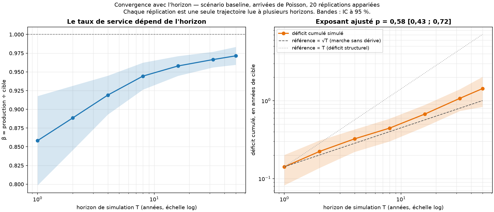
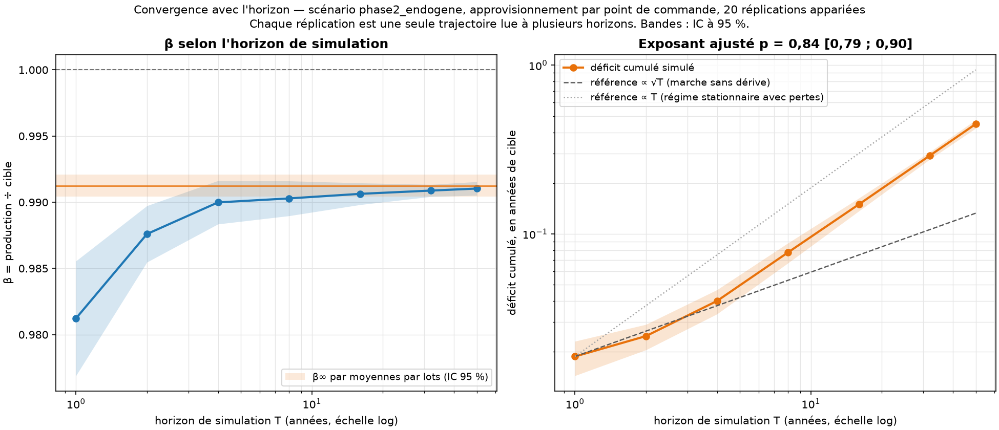
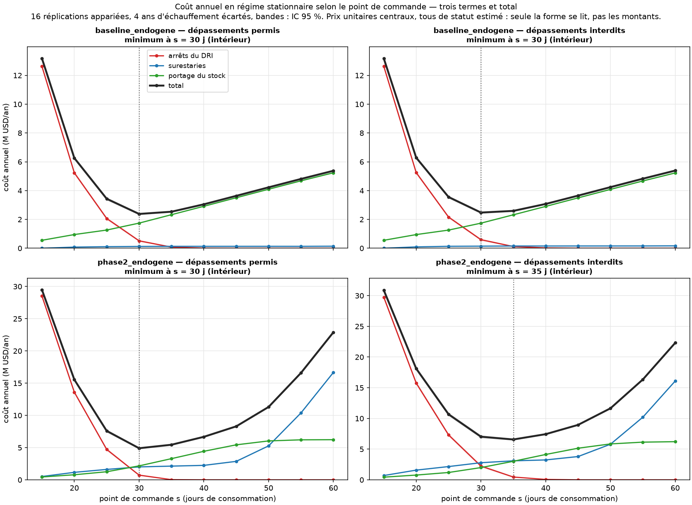
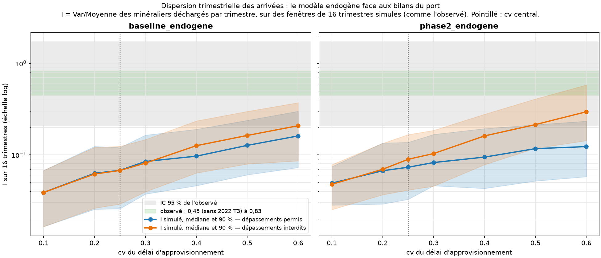
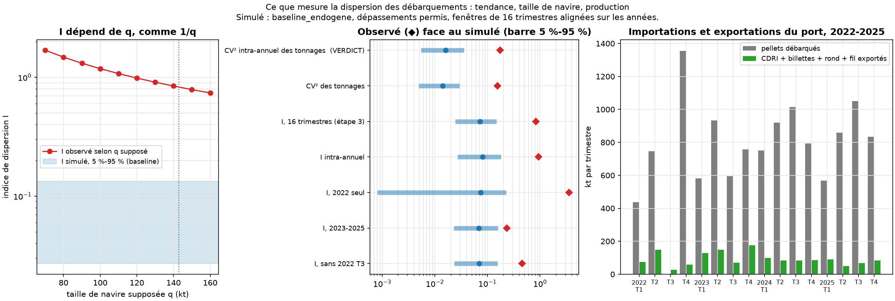
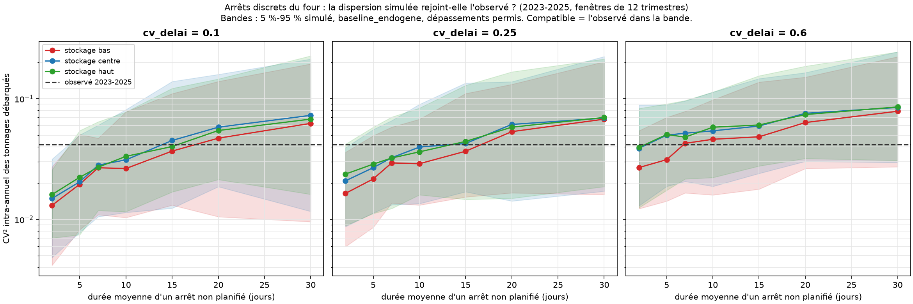
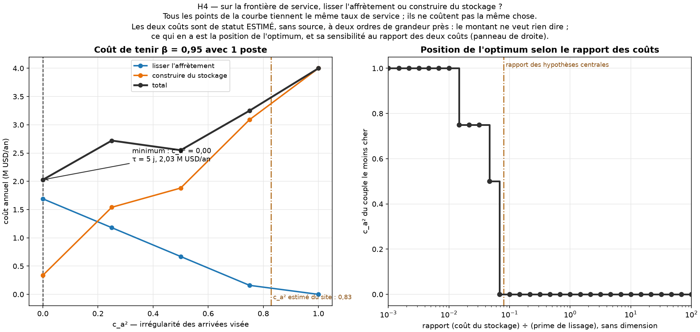
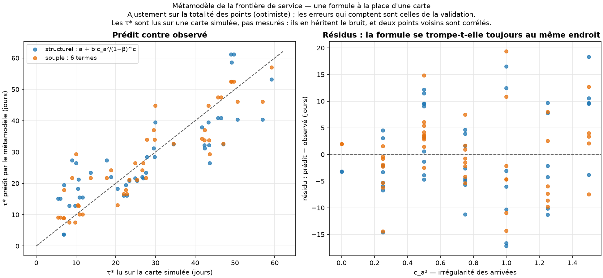
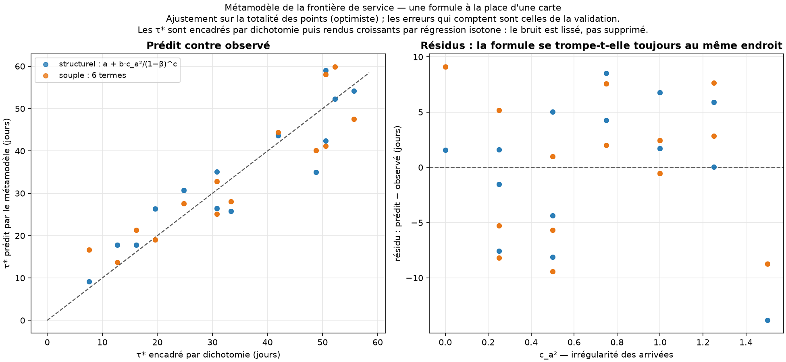

# Jumeau numérique du corridor Djen Djen–Bellara

**Question :** le corridor port de Djen Djen → rail → usine sidérurgique de Bellara
peut-il absorber un doublement de la production ? Si non, quel est le premier goulot ?

> Étude indépendante à but de portfolio, construite uniquement sur des données publiques.
> Non affiliée à Algerian Qatari Steel ni à l'Entreprise Portuaire de Djen Djen.

## État d'avancement

- [x] Semaine 1 : collecte automatique de la situation portuaire (3×/jour)
- [x] Semaines 2–3 : parser, normalisation, table des escales
- [x] Semaines 4–7 : simulation SimPy v1 et analyse de sensibilité
- [ ] Suite : ML, optimisation des stocks, tableau de bord

## Lancer en local

```bash
python -m venv .venv && source .venv/bin/activate   # Windows : .venv\Scripts\activate
pip install -e ".[dev]"
pytest -q                                   # 518 tests, hors ligne
pytest -m slow -q                           # + 5 tests lents : validation analytique
python -m corridor.ingest.port_status       # une collecte
python scripts/inspect_latest.py            # voir le contenu du dernier PDF
python scripts/ore_calls_report.py          # escales minerai, cadences, signal H2

python -m corridor.sim.run --scenario baseline --years 1 --reps 50
python -m corridor.sim.sensitivity          # la figure ci-dessous, ~3 min 30
python scripts/h2_blocking.py --reps 30     # hypothèse H2 : blocage du poste, ~5 min
python scripts/poste_stockage_factoriel.py  # plan 2x2 poste x stockage, ~3 min
python scripts/frontiere_service.py --reps 60   # frontière de service, ~25 min
python scripts/cout_regularite.py           # H4 : lisser l'affrètement ou stocker ?
```

### Installer le hook de pré-commit (recommandé)

`pytest -q` **n'exécute pas** la validation analytique du moteur de file : elle est marquée
`slow` pour tenir le budget d'une trentaine de secondes. Une régression du moteur passerait
donc inaperçue en local. Le hook fourni referme ce trou — il lance `pytest -m slow -q`
uniquement quand un fichier de `src/corridor/sim/` est mis à l'index, et ne coûte rien aux
autres commits :

```bash
git config core.hooksPath scripts/hooks
```

Il se contourne par `git commit --no-verify` : c'est un garde-fou, pas une serrure. Si votre
interpréteur n'est pas celui que le hook trouve tout seul, indiquez-le par
`CORRIDOR_PYTHON=/chemin/vers/python`.

## Premiers résultats observés

> **Lecture de ce README.** Ce projet vise un *application paper* dans *Computers & Industrial
> Engineering*, jugé sur trois critères : **originalité**, **généralité**, **importance**.
> Chaque section de résultat indique lequel des trois elle sert — et une section qui n'en sert
> aucun est du travail honnête, mais hors sujet pour l'article.


Ce qui suit n'est pas de la simulation : c'est ce que la série de situations portuaires
collectée du **2026-09-24 au 2026-10-22** (82 collectes, 1 138 observations de navires,
49 escales reconstruites) dit des minéraliers. Reproductible par
`python scripts/ore_calls_report.py`.

### Les quatre escales minerai de la série

*Sert l'**originalité** : une calibration tirée d'une collecte publique, sans accès au site.*

| Navire | Tonnage publié | Arrivée | Accostage | Départ encadré | Séjour à quai | Attente en rade | Cadence apparente |
| --- | ---: | --- | --- | --- | ---: | ---: | ---: |
| BERGE NIMBA | 140 571 t | 17/09 06:00 (rade) | 24/09 21:10 | 30/09 18:21 → 01/10 00:27 | ≥ 141,2 h | **183,2 h** | 22 900 – 23 900 t/j |
| GH NIGHTINGALE | 142 533 t | 18/09 20:48 (quai) | 18/09 20:48 | 24/09 15:58 → 24/09 23:03 | ≥ 139,2 h | non mesurable | 23 400 – 24 600 t/j |
| SOMNIUM AUSTRALIS | 138 955 t | 13/10 23:20 (quai) | 13/10 23:20 | 19/10 10:39 → 19/10 19:12 | ≥ 131,3 h | non mesurable | 23 800 – 25 400 t/j |
| IAN M | 141 755 t | pas encore arrivé | — | escale en cours | — | — | — |

IAN M n'est encore qu'une annonce au 2026-10-22 (*Expected Arrivals*, ETA 27/10) : ni rade ni
quai, donc aucune durée. Les trois escales terminées sont passées par le **même poste, QW/7**,
avec des tonnages très proches (139 à 143 kt). Chaque cadence est une fourchette parce que le départ n'est jamais
observé directement : la borne haute suppose le départ le plus tôt possible dans la fenêtre
(`departure_min`), la borne basse le plus tard. C'est une cadence **apparente sur l'occupation
du poste** — amarrage, temps morts et attente de rames compris — et non un débit de grue ; c'est
précisément ce que le modèle appelle `cadence_dechargement`. La moyenne des trois valeurs
centrales, **24 000 t/jour**, a fait passer
[`navires_minerai.cadence_dechargement`](config/assumptions.yaml) du statut *estimé* (25 000,
fourchette [15 000 ; 40 000]) à **observé** (24 000, fourchette [22 900 ; 25 400]).

### Le poste unique crée bien une file : la relève NIGHTINGALE → NIMBA

*Sert l'**originalité** : un mécanisme de file observé dans une source ouverte, pas postulé.*

C'est la seule file d'attente que la série montre directement, et elle est nette :

| Instantané | QW/7 | BERGE NIMBA |
| --- | --- | --- |
| 24/09 15:58 | GH NIGHTINGALE, *iron ore in bulk* | en rade depuis le 17/09 06:00 |
| 24/09 23:03 | **BERGE NIMBA**, accostage publié à 21:10 | à quai |

Entre deux collectes espacées de sept heures, NIGHTINGALE libère QW/7 et NIMBA s'y amarre.
NIMBA avait alors passé **183 h (7,6 jours) en rade**, avec 140 571 t de minerai à bord, et son
accostage tombe dans la fenêtre même du départ du navire précédent. Le poste de déchargement
minerai se comporte donc comme une ressource à exclusion mutuelle : l'attente observée n'est pas
un aléa de navigation, c'est une file devant un quai occupé.

**Le contre-test de H2, et il ne trouve rien.** H2 dit que le quai est saturé par l'aval, pas
par sa propre cadence. Son signal observable serait un minéralier qui attend **alors que son
poste est vide** : chaque heure de ce genre est une heure que l'explication « le poste est le
goulot » ne couvre pas. `ore_calls_report.py` décompose donc chaque attente mesurable, en
comptant comme occupant **tout** navire au même poste — QW/7 reçoit aussi du non-minerai.
Sur la seule attente mesurable de la série :

| BERGE NIMBA, 183,2 h d'attente | heures | lecture |
| --- | ---: | --- |
| poste démontré occupé (GH NIGHTINGALE) | 139,2 h | la file s'explique |
| poste démontré libre | **0,0 h** | aucun signal H2 |
| dans la fenêtre de départ du navire précédent | 5,2 h | il y était peut-être encore |
| avant le premier instantané | 38,8 h | occupation inconnue, pas libre |

**La série ne montre donc aucune attente à poste libre.** Ce qui en avait l'air tombe
entièrement soit dans la fenêtre de départ de NIGHTINGALE — dont le départ est encadré, pas
observé — soit avant le 24/09, où l'occupation de QW/7 n'est pas connue. C'est un résultat,
pas une absence de résultat : sur cette série, rien ne contredit l'idée que le poste est pris
dès qu'un navire attend, et H2 n'y gagne ni n'y perd. Avec une seule attente mesurable, c'est
tout ce qu'on peut en dire.

Trois réserves de lecture, parce que cette observation sert d'appui à l'un des résultats du
modèle :

- **la relève est observée, les durées sont publiées.** La série commence le 24/09 15:58 : c'est
  la relève elle-même que nous voyons, d'un instantané au suivant. En revanche l'entrée en rade
  de NIMBA (17/09 06:00) et l'accostage de NIGHTINGALE (18/09 20:48) sont des heures d'événement
  lues dans le PDF, antérieures à notre collecte — les deux escales portent le code
  `left_censored` ;
- **ce n'est pas une file FIFO.** NIMBA attendait en rade depuis le 17/09 alors que NIGHTINGALE
  n'a accosté que le 18/09 : un navire est passé devant. La série ne commençant pas assez tôt,
  on ne sait pas qui occupait QW/7 avant le 18/09 ni pourquoi l'ordre a été celui-là ;
- **un cas n'est pas une statistique.** Une seule attente en rade est mesurable sur toute la
  série minerai. Elle montre que le mécanisme existe, pas à quelle fréquence il joue.

### Ce que ces observations ne permettent pas encore

- **La dispersion des arrivées n'est pas mesurable sur cette série.** Quatre arrivées de
  minéraliers, donc deux intervalles seulement : 1,6 jour entre NIMBA et NIGHTINGALE, puis
  25,1 jours avant SOMNIUM AUSTRALIS. Le schéma — deux arrivées presque simultanées puis près
  d'un mois de vide — va dans le sens d'arrivées très irrégulières, mais on ne tire pas un
  coefficient de variation de deux intervalles. Une estimation existe désormais, obtenue sur
  une **autre** source et sur quatre ans : voir la section suivante.
- **La cadence repose sur 3 navires de même gabarit au même poste.** Rien ne dit ce qu'elle
  vaudrait sur un autre poste ou un autre tonnage. Rien ne prouve non plus que le tonnage publié
  ait été déchargé en entier à Djen Djen : s'il reste du fret à bord, la cadence est surestimée.
  La dispersion inter-navires (`simulation.cv_cadence_dechargement` = 0,15) reste *estimée* : les
  trois valeurs mesurées sont à ± 2,5 % l'une de l'autre, bien moins dispersées, mais trois
  observations ne suffisent pas à resserrer ce coefficient.
- **Les deux capacités de stockage restent de statut *inconnu*** et ce sont elles qui dominent
  les résultats. Aucune observation de la série ne les éclaire.

### L'irrégularité des arrivées, première estimation sur 16 trimestres

*Sert l'**originalité** : le paramètre dimensionnant est estimé sur des bilans publics, là où la littérature le suppose ou l'obtient par accès interne.*

`simulation.dispersion_arrivees` est le dernier des deux paramètres dimensionnants à n'avoir
aucune source. La série de situations portuaires n'en donnera pas avant 2027 ; les **bilans de
trafic** que le port publie depuis 2022, eux, contiennent de quoi l'estimer — à condition
d'accepter une chaîne d'hypothèses qu'il faut regarder en face.

**La source.** Les pages « Trafic Marchandises Débarquées par catégorie de produit » détaillent
le tonnage par produit, et comportent une ligne **« Pellets »** (renommée « Pellets / DRI » à
partir de 2024) — le seul poste de la nomenclature qui corresponde à la matière première de
Bellara. 13 bilans, exercices 2022 à 2025, archivés dans `data/raw/port_stats/` avec leurs PDF
joints et un manifeste d'empreintes.

**La méthode, en trois pas, chacun avec son coût.**

1. Les bilans publient des **cumuls depuis le 1er janvier** (1er trimestre, 1er semestre, fin
   septembre, année). Un trimestre isolé s'obtient par différence. Chaque cumul étant publié
   deux fois — colonne de droite d'un bilan, colonne de gauche de celui de l'année suivante —
   la lecture est recoupée : **les 13 bilans sont cohérents sans une seule contradiction**.
2. Le nombre de navires d'un trimestre est estimé par tonnage ÷ taille moyenne d'un minéralier
   (142 700 t). **Ce n'est pas un comptage, c'est une division.**
3. L'**indice de dispersion** I = Var(N)/E[N] vaut 0 pour des arrivées régulières et 1 pour un
   processus de Poisson. Pour un processus de renouvellement, il tend vers c_a², ce qui autorise
   à le lire comme une estimation de c_a² — **asymptotiquement**.

| Trimestre | T1 | T2 | T3 | T4 |
| --- | ---: | ---: | ---: | ---: |
| **2022** | 437 400 t | 745 409 t | **606 t** | 1 355 756 t |
| **2023** | 582 664 t | 933 506 t | 596 171 t | 757 197 t |
| **2024** | 750 067 t | 920 046 t | 1 014 606 t | 792 978 t |
| **2025** | 567 848 t | 858 347 t | 1 049 760 t | 833 963 t |

Soit 5,34 navires par trimestre en moyenne, écart-type 2,10, et

> **I = 0,83**, intervalle de confiance à 95 % par bootstrap **[0,21 ; 1,73]**

`simulation.dispersion_arrivees_observee` passe donc à **0,91** (racine de I, puisque
l'hypothèse stocke un coefficient de variation et non son carré), fourchette [0,45 ; 1,31],
statut *estimé*. **Les arrivées de minéraliers à Djen Djen seraient donc proches d'un régime de
Poisson** — c'est-à-dire du cas le plus défavorable que le modèle explorait jusqu'ici en
hypothèse d'école.

**Un trimestre pèse très lourd.** Le troisième trimestre 2022 ne porte que **606 tonnes** de
pellets, soit un quasi-arrêt de l'approvisionnement sur trois mois. En l'écartant, I tombe à
0,45 [0,15 ; 0,77] — la moitié. Il n'est **pas** écarté du résultat publié : rien ne dit que ce
soit une erreur de la source plutôt qu'un arrêt réel de l'aciérie, et le retirer reviendrait à
choisir la réponse. L'écart entre 0,83 et 0,45 mesure à lui seul la fragilité de l'estimation.

**Quatre raisons de ne pas appeler cela une mesure.**

- **Les variations de consommation s'y mêlent.** Un trimestre creux peut venir d'arrivées
  irrégulières *ou* d'un four à l'arrêt. Rien ici ne les sépare, et I met toute la variance sur
  les arrivées : il **surestime** probablement c_a².
- **16 trimestres font une petite série**, et l'intervalle de confiance le dit : il couvre
  1,5 point, de « presque régulier » à « nettement groupé ».
- **La fenêtre trimestrielle lisse les rafales de quelques jours**, que la simulation voit. De
  ce côté-là, I **sous-estime** l'irrégularité. Les deux biais jouent en sens contraire et rien
  ne dit lequel domine.
- **Le nombre de navires est un tonnage divisé par une taille moyenne.** Un navire partiellement
  déchargé ou d'un autre gabarit se traduit en fraction de navire.

Reproductible par `python -m corridor.ingest.port_stats` puis
`python scripts/arrival_dispersion.py`.

## Résultats préliminaires

> ### ⚠️ Correction du 2026-10-25 : la capacité de stockage n'est pas un levier dans ce modèle
>
> En séparant les flux aléatoires (un générateur par source d'aléa), les différences appariées
> ont cessé d'être bruitées — et un zéro exact est apparu là où le projet lisait un gain.
> **Mesure : en faisant varier les deux capacités de stockage d'un facteur 12 (τ de 13 à
> 160 jours de couverture), à stock initial figé, la production de DRI varie de moins de
> 0,002 % — quelques dizaines de tonnes sur 3,7 Mt** (β = 0,9211 aux quatre facteurs), aux
> horizons de 1, 4 et 12 ans. À comparer au « gain du stockage » publié, +2,57 points, soit
> ~95 000 t : l'effet réel de la capacité est **plus de mille fois plus petit**. Ce qui change,
> c'est uniquement *où se trouve le minerai* : le blocage du quai tombe de 1 575 h à 0 et le
> tonnage en rade de 313 kt à 96 kt.
>
> **D'où venait alors le « gain du stockage » publié ?** Du **stock initial**. Les scénarios
> dérivent le stock de départ de la capacité (`fraction_stock_initial`), donc doubler la
> capacité double aussi les 225 kt présents à l'instant zéro. En décomposant : capacité haute
> seule, **+0,000 %** ; stock initial haut seul, **+3,438 %** ; les deux ensemble,
> **+3,439 %**. Tout l'effet est dans la condition initiale.
>
> **Le mécanisme est le même que celui du second poste, et le projet avait écrit le
> garde-fou sans l'appliquer ici** : quand le stockyard est plein, le navire garde sa
> cargaison à quai ou en rade. Le minerai n'est pas perdu, il est différé — la flotte *est*
> le tampon, et elle n'a pas de plafond. Le four ne s'arrête que lorsqu'il n'y a plus de
> minerai nulle part, ce qui dépend des arrivées et non de la taille des silos. Les silos
> déplacent la file, ils ne nourrissent pas le four.
>
> **Ce que cela invalide, en l'état :** le gain attribué au stockage dans le plan factoriel,
> la bande de perte de la grille de sensibilité (« de 200 kt à 900 kt, la perte passe de
> 14,1 % à 5,8 % »), et **l'axe τ de la frontière de service** — donc aussi l'arbitrage H4,
> le métamodèle et l'estimation directe, qui en dépendent tous. Les sections qui suivent sont
> conservées telles qu'elles ont été produites, chacune portant ce renvoi : les refaire
> demande d'abord de décider si le modèle doit plafonner le tampon flottant (surestaries,
> déroutement, fenêtres d'accostage), ce qui est aujourd'hui **hors périmètre** (limite 9).
> C'est le premier chantier du projet.
>
> Reproductible : voir `tests/test_sim_model.py`, section « flux aléatoires synchronisés ».

### Pourquoi : un modèle sans rétroaction n'a pas de taux de service stationnaire

*Sert la **généralité** : le diagnostic vaut pour tout modèle de corridor dont les arrivées
sont exogènes et calées sur la demande — c'est-à-dire pour la manière la plus courante de
construire un tel modèle.*

Dans le modèle actuel, le débit moyen d'arrivée est **exactement** celui de la demande
(`navires_par_an = besoin_annuel / taille_navire`, dérive relative mesurée : 1,6·10⁻¹⁶). L'offre
cumulée moins la demande cumulée est donc une marche aléatoire **sans dérive**. Bornée en bas
par zéro — le four s'arrête — et pas en haut — le navire garde sa cargaison —, elle produit un
déficit cumulé qui croît comme √T. Le taux de perte décroît alors en 1/√T, et β tend vers 1
sans jamais se stabiliser : **il n'existe aucun taux de service stationnaire inférieur à 1**.
Tout β publié est la valeur d'un transitoire, lue à l'horizon choisi.

Le script `scripts/convergence_horizon.py` a été écrit pour pouvoir **réfuter** ce diagnostic :
il ajuste le déficit en loi de puissance D ≈ a·T^p et regarde trois issues fixées d'avance —
p ≈ 1/2 (marche sans dérive : aucun régime stationnaire), p ≈ 1 (régime stationnaire avec
pertes : le corridor perd une fraction constante de sa production, et β converge vers une
limite inférieure à 1), p ≈ 0 (déficit borné : les pertes s'éteignent, β tend vers 1 en 1/T).
Baseline, arrivées de Poisson, 20 réplications jouées chacune de 1 à 50 ans sur une même
trajectoire :

| T (années) | 1 | 2 | 4 | 8 | 16 | 32 | 50 |
| --- | ---: | ---: | ---: | ---: | ---: | ---: | ---: |
| β | 0,858 | 0,888 | 0,919 | 0,944 | 0,958 | 0,967 | 0,971 |
| déficit cumulé (années de cible) | 0,14 | 0,22 | 0,32 | 0,45 | 0,67 | 1,07 | 1,43 |
| part de β due au stock initial | 0,070 | 0,036 | 0,018 | 0,009 | 0,005 | 0,002 | 0,001 |



- **Exposant du déficit : p = 0,578 [0,434 ; 0,718]** (R² = 0,997). Compatible avec 1/2,
  exclut 1 et 0. **À stock initial nul : p = 0,492 [0,367 ; 0,599].** L'écart entre les deux
  s'explique : le stock de départ réduit les déficits des horizons courts et raidit la pente
  apparente ; sans lui, on lit la marche elle-même, et elle tombe sur 1/2.
- **β croît sans palier** de 0,858 à 0,971 sur un demi-siècle simulé. Le « taux de service à un
  an » de toutes les sections qui suivent n'est donc pas une propriété du corridor, c'est une
  propriété du corridor *et* de l'horizon de lecture.
- **Le stock initial pèse un tonnage fixe**, pas une fraction : 63 à 64 % de S0 finit converti
  en production à tout horizon, si bien que sa part de β décroît exactement en 1/T. À un an il
  vaut 7 points de β — plus que la plupart des effets que le projet cherchait à mesurer.

**Correction de lecture.** La première version de ce script étiquetait p ≈ 1 « déficit
structurel », c'est-à-dire un défaut de capacité. C'était confondre deux causes qui donnent la
même pente : un corridor trop petit et un corridor stationnaire qui subit des ruptures
aléatoires perdent tous deux une fraction constante de leur production. p ≈ 1 dit seulement
qu'un régime stationnaire existe ; il ne dit rien de sa cause. Le diagnostic du modèle exogène
n'en est pas affecté — p y tombe sur 1/2, pas sur 1.

**Conséquence pour la suite.** Mesurer mieux ne sert à rien tant que le modèle n'a pas de
rétroaction : il faut une politique d'approvisionnement qui commande en fonction du stock, ce
qui rend au système une dérive de rappel et donc un régime stationnaire. Le critère qu'elle
doit passer porte sur **β**, pas sur l'exposant : β doit cesser de bouger au-delà de quelques
années, et deux estimateurs construits différemment — réplications indépendantes et moyennes
par lots sur une seule longue trajectoire — doivent donner la même limite. Si des ruptures
subsistent, le déficit croît alors comme T et p tombe sur 1 : c'est le signe attendu d'un
régime stationnaire, pas un échec.

### L'approvisionnement endogène rend au corridor un régime stationnaire

*Sert l'**originalité** : l'irrégularité des arrivées cesse d'être une hypothèse d'entrée et
devient une sortie du modèle, produite par une politique de commande et la variabilité du
délai. Sert aussi la **généralité** : la politique (s, Q) sur position de stock se transpose
telle quelle à tout corridor d'importation.*

Les scénarios `baseline_endogene` et `phase2_endogene` remplacent les arrivées exogènes par une
**politique de commande** : un minéralier est affrété dès que la position de stock — stockyard,
usine, rail en transit, navires en rade (cargaison encore à bord comprise) et navires en mer —
passe sous le point de commande s. Trois paramètres, tous de statut *estimé* et sans source :
délai d'approvisionnement 22 jours [15 ; 30], variabilité du délai cv = 0,25 [0,10 ; 0,60],
point de commande 30 jours de consommation [15 ; 60]. Les scénarios `baseline` et `phase2`
restent exogènes : la validation contre Pollaczek-Khinchine exige des arrivées de Poisson
exogènes. Ils n'ont pas bougé d'un bit — vérifié sur 12 cas contre le commit précédent.

**Le critère porte sur β, et il est passé dans les deux scénarios.** 20 réplications appariées
de 1 à 50 ans, plus une réplication unique de 400 ans coupée en 99 lots de 4 ans :

| | baseline_endogene | phase2_endogene |
| --- | ---: | ---: |
| **β∞, moyennes par lots** | **0,9867 ± 0,0012** | **0,9912 ± 0,0008** |
| β à 50 ans, réplications indépendantes | 0,9870 ± 0,0008 | 0,9910 ± 0,0005 |
| écart entre les deux estimateurs | −0,0003 ± 0,0014 → accord | +0,0002 ± 0,0010 → accord |
| β à 1 / 4 / 8 ans | 0,991 / 0,987 / 0,988 | 0,981 / 0,990 / 0,990 |
| différences appariées au-delà de 8 ans | toutes non significatives | toutes non significatives |
| heures ouvrées en rupture | 1,33 % | 0,88 % |
| années avec au moins une rupture | 83 % | 82 % |
| exposant du déficit, tous horizons | 1,07 [0,97 ; 1,22] | 0,84 [0,79 ; 0,90] |
| exposant du déficit, T ≥ 8 ans | 1,05 [0,95 ; 1,13] | 0,96 [0,88 ; 1,03] |



**Ce qui change par rapport au modèle exogène :**

- **β a une limite.** Il est à 0,1 point d'elle dès 4 ans, et plus aucune différence entre
  horizons successifs n'est significative au-delà de 8 ans. En exogène, il montait encore de
  0,5 point entre 32 et 50 ans. Un « taux de service » redevient une propriété du corridor
  plutôt que de l'horizon de lecture.
- **Le déficit croît comme T**, et c'est le signe attendu : le corridor perd une fraction
  constante de sa production, 1,3 % en baseline et 0,9 % en phase 2. Les ruptures sont
  rares mais régulières — plus de quatre années sur cinq en voient au moins une.
- **Le quai ne se bloque presque plus.** On ne commande pas ce qu'on n'a pas la place de
  recevoir : la politique plafonne d'elle-même le minerai à flot, ce que le modèle exogène ne
  savait pas faire (limite 0). Reste à vérifier, à l'étape 4, si la capacité de stockage
  redevient un levier.
- **Le démarrage n'est plus un cadeau mais une dette, en phase 2.** Les 225 kt de stock
  initial ne couvrent pas la consommation pendant le délai (~372 kt) : la première année
  subit une rupture certaine (β = 0,981). C'est ce qui fait tomber l'exposant global à 0,84 —
  un déficit affine D ≈ c·T + d, qu'une loi de puissance lit comme une pente plus faible.
  Restreint aux horizons où le transitoire est amorti, il revient à 0,96 [0,88 ; 1,03], compatible avec 1. **Cet
  exposant hors transitoire a été ajouté après avoir vu le résultat de phase 2** ; la raison
  en est mécanique et prévisible, mais il faut le savoir.

**Une hypothèse de modélisation pèse 1,7 point, et elle inverse le classement.** La phase 2
perd *moins* que la baseline (0,9 % contre 1,3 %), alors qu'elle passe deux fois plus de
commandes avec la même marge de sécurité en jours. La cause est mesurée, pas supposée : les
délais sont tirés indépendamment pour chaque commande, donc un navire en retard peut être
doublé par le suivant. Avec ~2,6 commandes en route à la fois, cela arrive à 12,7 % des
arrivées en phase 2, contre 2,2 % en baseline. En interdisant les dépassements (12 graines,
20 ans), la phase 2 tombe de **0,9917 à 0,9749** pendant que la baseline ne bouge presque pas
(0,9893 → 0,9878) — et l'ordre s'inverse. L'hypothèse est réaliste pour des affrètements
indépendants venus d'origines différentes, optimiste pour une navette sur une seule route.
**Toute comparaison entre scénarios endogènes de cadences différentes devra être publiée sous
les deux hypothèses.**

Reproductible par `python scripts/convergence_horizon.py --scenario phase2_endogene
--lots-annees 400` (~15 min par scénario).

### Ce que coûte un point de commande : un optimum intérieur, et il est robuste

*Sert l'**importance** : c'est la question de dimensionnement qu'un approvisionneur se pose —
combien de jours de stock faut-il avoir engagés pour commander ? Sert aussi la **généralité** :
la forme du coût et la position de l'optimum s'expriment en jours de consommation, donc se
transposent.*

Tout est mesuré **en régime stationnaire** (4 ans d'échauffement écartés, 16 ans mesurés,
16 réplications appariées), sur les deux scénarios endogènes, et **sous les deux hypothèses de
dépassement** — délais indépendants, ou navette où chaque navire arrive après le précédent. Le
coût annuel a trois termes, toujours publiés séparés : **arrêts du DRI** (production manquante ×
marge par tonne), **surestaries** (navire-heures en rade × 1 250 USD/h) et **portage** (stock
physique moyen × 140 USD/t × 10 %/an). Les trois prix sont de statut *estimé*, sans source
locale : **seule la forme se lit, pas les montants**.

**Coût au point de commande central (s = 30 jours)**, M USD/an, IC 95 % sur la simulation :

| scénario | dépassements | arrêts DRI | surestaries | portage | **total** |
| --- | --- | ---: | ---: | ---: | ---: |
| baseline_endogene | permis | 0,51 ± 0,07 | 0,12 ± 0,01 | 1,74 ± 0,01 | **2,38 ± 0,08** |
| baseline_endogene | interdits | 0,59 ± 0,08 | 0,14 ± 0,02 | 1,74 ± 0,01 | **2,48 ± 0,09** |
| phase2_endogene | permis | 0,73 ± 0,10 | 2,01 ± 0,07 | 2,16 ± 0,02 | **4,90 ± 0,13** |
| phase2_endogene | interdits | 2,24 ± 0,22 | 2,79 ± 0,08 | 2,00 ± 0,02 | **7,03 ± 0,26** |

En baseline, le portage domine : on paie surtout le stock de sécurité. En phase 2, les
surestaries pèsent autant que lui, parce qu'un navire tous les 8 jours pour ~6 jours de
déchargement fait souvent attendre le suivant. Et l'hypothèse de dépassement y vaut **2,1 M
USD/an** : sans dépassement, les arrêts du DRI triplent.

**L'option de report n'apporte rien, et en phase 2 elle nuit.** Différences appariées option −
base, à s = 30 jours :

| scénario | dépassements | β (points) | attente en rade | coût total (M USD/an) |
| --- | --- | ---: | ---: | ---: |
| baseline_endogene | permis | −0,009 ± 0,008 | +0,0 ± 0,1 h | −0,002 ± 0,004 |
| baseline_endogene | interdits | −0,017 ± 0,013 | +0,1 ± 0,1 h | +0,001 ± 0,006 |
| phase2_endogene | permis | **−0,56 ± 0,14** | **+3,4 ± 1,3 h** | **+0,51 ± 0,17** |
| phase2_endogene | interdits | **−2,49 ± 0,40** | **+11,4 ± 2,5 h** | **+2,46 ± 0,43** |

En baseline, l'effet sur β est statistiquement détectable mais vaut un centième de point : la
position de stock compte déjà le navire en rade, et l'option est redondante. En phase 2 elle
fait perdre jusqu'à 2,5 points de taux de service et **allonge** l'attente qu'elle devait
réduire : reporter une commande pendant qu'un navire attend, c'est commander plusieurs navires
d'un coup quand il accoste, et ils arrivent groupés. **L'option est donc écartée**, et c'est un
résultat : la politique sur position de stock fait déjà ce que le report prétendait faire, et
mieux.



**La courbe de coût en s est un U, avec un optimum intérieur dans les quatre cas** — à
**30 jours** en baseline et en phase 2 avec dépassements, à **35 jours** en phase 2 sans
dépassement. Il est significatif au sens fort : en données appariées, le coût en s* est
plus bas qu'aux deux bords du domaine (15 et 60 jours) dans chacun des quatre cas. Trois
lectures :

- **La courbe est très asymétrique : manquer coûte bien plus que trop stocker.** En baseline,
  15 jours trop bas coûtent +10,8 M USD/an, 30 jours trop haut +3,0 M. À s = 15 jours le
  corridor ne tient plus que 72 % de sa cible. Dans le doute, il faut se tromper vers le haut.
- **Les deux branches n'ont pas la même cause selon le scénario.** En baseline, la branche
  droite est le portage, linéaire. En phase 2, ce sont les surestaries, qui **explosent**
  au-delà de 45 jours : le stock physique plafonne à ~445 kt (les deux silos sont pleins) et le
  surplus engagé attend en rade, 103 h en moyenne à s = 50 jours, 327 h à s = 60. **La capacité
  physique de stockage redevient donc un facteur**, non plus par la production comme le croyait
  le modèle exogène, mais par les surestaries. C'est ce que l'étape suivante devra chiffrer.
- **L'optimum bouge peu avec les prix.** En multipliant le prix de l'arrêt et celui des
  surestaries par 0,1 à 10 chacun — deux ordres de grandeur, portage fixé —, s* reste entre
  **15 et 40 jours** dans les quatre cas, sans jamais atteindre la moitié haute du domaine.
  Dès que l'arrêt coûte au moins le tiers de sa valeur centrale, il reste entre **25 et 40
  jours**, à une exception près : en phase 2, quand les surestaries sont en plus décuplées, il
  tombe à 15 jours. C'est le rapport **arrêt / portage** qui le déplace le plus : de 25 à 40
  jours en baseline quand il est multiplié par 30. Le prix des surestaries ne le déplace que
  lorsque l'arrêt est bon marché — un peu en baseline, nettement en phase 2.

**L'attente simulée face à la seule observée : un écart net, qui pointe vers l'étape 3.**
L'unique attente minerai mesurable de la série de situations portuaires est celle de BERGE
NIMBA, **183,2 h** (lue dans `data/clean/observations.csv`, censurée à gauche). Distribution
simulée sur 60 ans en régime stationnaire, s = 30 jours :

| configuration | navires | moyenne | médiane | p90 | p99 | max | part sans attente | ≥ 183 h |
| --- | ---: | ---: | ---: | ---: | ---: | ---: | ---: | ---: |
| baseline_endogene, permis | 1 210 | 4,2 h | 0 h | 0 h | 123 h | 160 h | 94 % | **0,0 %** |
| baseline_endogene, interdits | 1 207 | 4,8 h | 0 h | 0 h | 136 h | 172 h | 94 % | **0,0 %** |
| phase2_endogene, permis | 2 428 | 40,4 h | 0 h | 129 h | 221 h | 324 h | 54 % | 2,7 % |
| phase2_endogene, interdits | 2 388 | 57,5 h | 3,6 h | 161 h | 307 h | 452 h | 49 % | 6,4 % |

**Sur 1 200 navires simulés au rythme actuel, aucun n'attend autant que BERGE NIMBA** : 183 h
dépasse le maximum de la distribution baseline. Une observation isolée ne réfute rien, mais
elle dit où regarder. Trois explications candidates, aucune tranchée : les arrivées réelles
sont plus irrégulières que ce que produit la politique de commande — la série en montre deux
à 1,6 jour d'intervalle —, ce que l'**étape 3** testera en comparant le c_a² simulé au c_a²
mesuré ; AQS ne commande pas selon une politique de point de commande ; ou l'attente observée
a des causes hors modèle. **C'est un recoupement, pas une validation**, et il est défavorable
au modèle endogène en baseline.

Reproductible par `python scripts/politique_commande.py` (~50 min) et
`python scripts/economic_summary.py --stationnaire --reps 16`.

### Validation par la dispersion des arrivées : le modèle endogène est trop régulier

*Sert l'**originalité** par la méthode : une validation pré-enregistrée contre une donnée
publique, dont les règles ont été écrites avant le premier calcul. Sert aussi la
**généralité** : l'argument de bilan de masse qui explique l'échec vaut pour tout corridor, et
il change ce qu'on peut lire dans des statistiques portuaires trimestrielles.*

Dans le modèle endogène, l'irrégularité des arrivées n'est plus une hypothèse : elle sort de
la politique de commande et de la variabilité du délai. La comparer à celle que mesurent les
bilans du port est donc une **validation**, pas un réglage. Les règles sont figées dans
`scripts/validation_ca2.py` avant tout calcul :

- **statistique** : l'indice de dispersion des comptages trimestriels de minéraliers,
  I = Var/Moyenne, calculé **exactement** comme sur les données du port (tonnage déchargé par
  trimestre ÷ taille moyenne, même fonction) ;
- **comparaison à 16 trimestres** : l'observé est jugé contre la distribution de I sur des
  fenêtres de 16 trimestres simulés, ce que 16 trimestres peuvent produire, et non contre une
  moyenne de long terme ;
- **bandes** : large = IC à 95 % de l'observé, [0,21 ; 1,73] ; étroite = les deux variantes
  publiées, [0,45 ; 0,83]. Le modèle est *compatible* avec une bande si son intervalle à 90 %
  la rencontre ;
- **seul s est calibré**, sur un critère étranger à la dispersion (l'optimum en coût de
  l'étape 2) ; `cv_delai` reste à sa valeur d'hypothèse, 0,25, et le script refuse de tourner
  si elle a bougé. Le balayage de `cv_delai` est une carte de sensibilité, pas un réglage.

**Verdict à cv_delai central : trop régulier, pour les deux bandes et dans les quatre cas.**
8 graines × 100 ans en régime stationnaire, soit 200 fenêtres disjointes par configuration :

| configuration | I médian [5 % ; 95 %] | P(I ≥ 0,83) | P(I ≥ 0,45) | bande large | bande étroite |
| --- | ---: | ---: | ---: | --- | --- |
| baseline, dépassements permis | 0,069 [0,028 ; 0,133] | 0 % | 0 % | trop régulier | trop régulier |
| baseline, dépassements interdits | 0,067 [0,027 ; 0,125] | 0 % | 0 % | trop régulier | trop régulier |
| phase 2, dépassements permis | 0,075 [0,034 ; 0,137] | 0 % | 0 % | trop régulier | trop régulier |
| phase 2, dépassements interdits | 0,089 [0,040 ; 0,174] | 0 % | 0 % | trop régulier | trop régulier |

**Sur toute la fourchette de cv_delai, la bande étroite n'est jamais atteinte au rythme
actuel.** I monte avec la variabilité du délai, mais lentement :

| cv_delai | 0,10 | 0,20 | 0,25 | 0,30 | 0,40 | 0,50 | 0,60 |
| --- | ---: | ---: | ---: | ---: | ---: | ---: | ---: |
| baseline, permis — I médian | 0,039 | 0,063 | 0,068 | 0,085 | 0,097 | 0,127 | 0,161 |
| baseline, interdits — I médian | 0,039 | 0,062 | 0,068 | 0,081 | 0,126 | 0,163 | 0,209 |
| phase 2, permis — I médian | 0,049 | 0,067 | 0,073 | 0,083 | 0,095 | 0,117 | 0,123 |
| phase 2, interdits — I médian | 0,048 | 0,070 | 0,090 | 0,104 | 0,161 | 0,215 | 0,296 |

- la **bande large** n'est rejointe qu'à partir de **cv = 0,40 à 0,50**, et seulement par sa
  borne basse (0,21) ;
- la **bande étroite** ne l'est qu'en un seul point : phase 2, dépassements interdits,
  cv = 0,60, le bord de la fourchette, avec P(I ≥ 0,45) = 17 % et P(I ≥ 0,83) = 0 %. Or les
  données de 2022-2025 décrivent le corridor **actuel**, donc la baseline, qui n'y parvient
  pour aucune valeur ;
- ces valeurs de cv ne sont **pas plausibles pour un délai de transport.** Un délai moyen de
  22 jours avec un cv de 0,5 suppose un écart-type de ~11 jours : un navire sur trois
  arriverait avec plus de dix jours d'avance ou de retard. La traversée elle-même varie de
  quelques jours tout au plus ; seuls des files d'attente au port de chargement et des
  affrètements très erratiques donneraient un tel ordre de grandeur, et rien de public ne le
  documente pour AQS. **La validation n'est donc pas obtenue** ;
- le verdict ne dépend pas du seul paramètre calibré : à s ± 5 jours, I médian ne bouge pas
  (0,067 à 0,070 en baseline).



**Pourquoi : un bilan de masse, et il vaut pour tout corridor.** Sur un trimestre, le tonnage
déchargé égale la consommation plus la variation du stock physique. Dans le modèle, la
consommation est presque constante : sur 400 trimestres simulés en baseline, elle ne pèse que
0,002 dans un I de 0,059 ; tout le reste vient du stock, dont la variation trimestrielle a un
écart-type de 78 kt. Pour atteindre I = 0,45, il faudrait 215 kt d'écart-type, et 292 kt pour
0,83 — **avec 450 kt de capacité totale, le stock devrait passer presque de vide à plein d'un
trimestre à l'autre.** Une politique de commande qui suit la consommation ne peut pas produire
cela, quel que soit le délai. C'est aussi pourquoi le CV² des intervalles entre arrivées (0,20
en baseline, jusqu'à 0,61 en phase 2) ne dit pas grand-chose de I : un intervalle court y est
suivi d'un long, et sur un trimestre les écarts se compensent.

Conséquence pour la lecture de l'estimation publiée (I = 0,83) : **elle ne mesure c_a² que si
les arrivées sont exogènes**. Dès qu'il y a rétroaction, la dispersion des débarquements
trimestriels mesure d'abord **la variabilité de la consommation** et les grands mouvements de
stock — ce que la limite 5 soupçonnait déjà comme une source de surestimation.

**Contrôles de regroupement, à cv central : ils pointent dans la même direction**, sans rien
trancher. Une seule série courte est observée : 2 intervalles entre arrivées mesurés, dont un
de 1,6 jour, et une seule attente mesurable, 183 h.

| configuration | P(intervalle < 2 j) | chance de voir ≥ 1 sur 2 | P(attente > 150 h) | chance de voir 1 sur 1 |
| --- | ---: | ---: | ---: | ---: |
| baseline, permis | 1,9 % | 3,8 % | 0,3 % | 0,3 % |
| baseline, interdits | 2,6 % | 5,1 % | 0,7 % | 0,7 % |
| phase 2, permis | 12,2 % | 22,9 % | 6,2 % | 6,2 % |
| phase 2, interdits | 20,5 % | 36,8 % | 14,9 % | 14,9 % |

Au rythme actuel, le modèle rend chacun des deux faits observés peu probable (5 % au plus).
Pris isolément, aucun ne pèse : ce sont une ou deux observations. Mais les trois indicateurs —
dispersion trimestrielle, intervalle court, attente longue — vont dans le même sens : **les
arrivées réelles sont plus groupées que ce que produit une politique de commande sur
consommation constante.**

**Ce qui pourrait l'expliquer — rien n'est corrigé ici, le choix se fera avec le porteur du
projet.** Chaque mécanisme découple, d'une façon différente, les débarquements de la
consommation :

1. **Une consommation variable.** Montée en cadence, arrêts de four, campagnes de production :
   le modèle la tient constante, et le bilan de masse dit que c'est l'explication la plus
   directe. Le trimestre 2022 T3, quasi vide (606 t), en est peut-être un exemple ;
2. **Des contrats à fenêtres fixes.** Enlèvements programmés à date (laycans contractuels),
   indépendants du stock : les arrivées suivent un calendrier, pas un seuil ;
3. **Plusieurs fournisseurs**, chacun avec son propre calendrier et ses propres délais (Brésil,
   Canada, d'autres encore) : leurs superpositions créent des grappes ;
4. **Des navires pour d'autres destinataires.** La ligne « Pellets » des bilans ne distingue
   pas l'importateur : si une partie ne va pas à AQS, la statistique mêle deux flux ;
5. **Des commandes groupées** : achats par lots quand les prix ou le fret sont favorables, et
   constitution délibérée de stock ;
6. et, côté mesure, le nombre de navires est un tonnage divisé par une taille moyenne, pas un
   comptage (limite 5).

Reproductible par `python scripts/validation_ca2.py` (plusieurs heures sur batterie, ~1 h sur
secteur).

### Diagnostic de la mesure : l'écart n'est pas un artefact

*Sert l'**originalité** par la méthode : avant de modifier un modèle qui échoue, on vérifie
que la donnée qui le juge mesure bien ce qu'on croit. Sert aussi la **généralité** : les
trois corrections — tendance, taille de navire, production — s'appliquent à toute
estimation de la régularité des arrivées tirée de statistiques portuaires trimestrielles.*

L'étape précédente juge le modèle endogène trop régulier. Trois suspects pourraient tenir à
la statistique observée plutôt qu'au modèle : une **tendance** des importations d'une année à
l'autre, comptée à tort comme de l'irrégularité ; la **taille de navire** supposée, puisque
I varie comme 1/q ; et une **production** variable, que les importations suivraient.
`scripts/diagnostic_dispersion.py` teste les trois **sans toucher au modèle**, en appliquant
chaque calcul à l'identique aux données et aux comptages simulés de l'étape 3, sur des
fenêtres de 16 trimestres alignées sur les années.

**La règle, écrite avant le calcul.** L'indice corrigé soumis au verdict est le **CV²
intra-annuel des tonnages trimestriels** : la variance autour de la moyenne de chaque année,
rapportée au carré de la moyenne générale. C'est le seul indice qui retire à la fois la
tendance et la taille de navire, puisqu'il ne contient que des tonnages mesurés. S'il tombe
entre les quantiles 5 % et 95 % de sa distribution simulée, le modèle n'est pas réfuté ;
sinon, l'écart demeure. Le verdict se lit sur `baseline_endogene`, le corridor que décrivent
les données.

**Verdict : l'écart demeure.** CV² intra-annuel observé **0,174**, contre **[0,006 ;
0,032]** simulé (médiane 0,016), sous les deux hypothèses de dépassement — cinq fois le 95e
centile. **Aucune variante ne le contredit** : toutes tombent hors de leur distribution
simulée, dans les quatre configurations.

| indice (baseline, dépassements permis) | observé | simulé médian [5 % ; 95 %] |
| --- | ---: | ---: |
| **CV² intra-annuel des tonnages (verdict)** | **0,174** | 0,016 [0,006 ; 0,032] |
| CV² des tonnages | 0,155 | 0,014 [0,005 ; 0,027] |
| I sur 16 trimestres (étape 3) | 0,829 | 0,072 [0,027 ; 0,134] |
| I intra-annuel | 0,931 | 0,081 [0,030 ; 0,164] |
| I sur 2022 seul | 3,581 | 0,074 [0,001 ; 0,206] |
| I sur 2023-2025 | 0,231 | 0,068 [0,025 ; 0,142] |
| I sans 2022 T3 | 0,451 | 0,069 [0,026 ; 0,140] |



Ce que chaque correction dit :

- **Pas de tendance.** Retirer la moyenne de chaque année *augmente* I (0,83 → 0,93) au lieu
  de le réduire : la dispersion est à l'intérieur des années, pas entre elles. Les
  importations croissent pourtant (2,5 Mt en 2022, 3,5 Mt en 2024), mais cette pente pèse peu
  face aux écarts d'un trimestre au suivant.
- **2022 porte l'essentiel, mais pas tout.** Un trimestre quasi vide (2022 T3, 0,6 kt) suivi
  du plus gros de la série (2022 T4, 1 356 kt) fait monter I à 3,6 sur cette seule année. Sur
  2023-2025, I tombe à 0,23 — mais reste au-dessus du 95e centile simulé (0,14). L'écart n'est
  donc pas l'affaire d'un trimestre anormal.
- **La taille de navire ne l'explique pas.** I observé varie de 1,69 (q = 70 kt) à 0,74
  (q = 160 kt) ; pour retomber sous le 95e centile simulé, il faudrait des navires de
  **885 kt**. Les quatre minéraliers observés depuis septembre portent de 139 à 143 kt, à
  moins de 3 % de la taille retenue : la flotte est homogène. Des deux indices, **le CV² est le
  plus défendable**, parce qu'il ne suppose aucune taille ; ici les deux concluent pareil,
  justement parce que la flotte est homogène.
- **Le volume, lui, est juste.** Le modèle débarque 719 kt par trimestre en moyenne, contre
  762 observés (−6 %) : la comparaison des CV², sans dimension, porte bien sur la seule
  irrégularité.

**La production indépendante ne dit rien de la variabilité de la consommation.** Les bilans
d'embarquement du port, archivés pour l'occasion (14 pages, période lue dans l'en-tête de
chaque tableau parce qu'adresses et titres se trompent trois fois), donnent les exportations
trimestrielles de CDRI, billettes, rond à béton et fil machine :

| corrélation avec les pellets débarqués | même trimestre | un trimestre de décalage |
| --- | ---: | ---: |
| exportations totales | 0,14 [−0,53 ; 0,62] | 0,02 [−0,64 ; 0,56] |
| CDRI seul | 0,18 [−0,35 ; 0,63] | −0,04 [−0,73 ; 0,63] |

Les intervalles couvrent tout, de fortement négatif à fortement positif : **rien n'est
mesurable**. Deux raisons, et elles tiennent à la source, pas à l'échantillon. Les
exportations sont petites — ~95 kt par trimestre face à ~760 kt de pellets importés — parce
que **les ventes locales de l'aciérie partent par la route et n'apparaissent dans aucun bilan
portuaire**. Et elles sont aussi irrégulières que les importations (CV² 0,185 contre 0,155),
parce qu'une exportation est une cargaison entière : les billettes de 2023 sont toutes
parties au premier trimestre. Un indice, pas une preuve : 2022 T3, le trimestre sans pellets,
est aussi celui des exportations les plus basses de la série (28 kt).

Quatre publications contradictoires ont été trouvées et tranchées explicitement (majorité,
puis page de l'année elle-même) : deux coquilles dans la page du 1er semestre 2023 publiée
deux fois, une ligne DRI absente de la page 2022, et un tonnage de rond à béton 2022 recopié
par erreur depuis une autre ligne sur la page 2023.

**Ce que cela implique.** L'écart entre le modèle endogène et les données n'est ni une
tendance, ni un effet de taille de navire, ni l'œuvre d'un seul trimestre. Il est réel. La
variabilité de la consommation reste la piste la plus directe selon le bilan de masse, mais
**les données publiques ne permettent ni de la confirmer ni de l'exclure**. Le choix du
mécanisme reste ouvert.

Reproductible par `python -m corridor.ingest.port_stats --serie embarquement` (collecte
ponctuelle) puis `python scripts/diagnostic_dispersion.py` (~15 min sur secteur).

### Des arrêts discrets du four : le modèle n'est plus réfuté sur 2023-2025

*Sert l'**originalité** : la dispersion des débarquements est expliquée par un mécanisme
physique, l'arrêt intermittent du four, et non par un réglage. Sert l'**importance** :
l'irrégularité de la consommation coûte au corridor autant que celle de l'affrètement, et
elle déplace le stock de sécurité optimal.*

Le bilan de masse désignait la **variabilité de la consommation** comme la piste la plus
directe. Le four a désormais un mode `discret` : il tourne à **pleine cadence** ou s'arrête,
au lieu de tourner en permanence à 85 % de sa capacité. La **disponibilité moyenne est
inchangée** — les arrêts non planifiés durent en moyenne `duree_arret_non_planifie_j` (7
jours, fourchette [2 ; 30], statut *estimé*, sans source) et les marches qui les séparent
s'en déduisent pour que le four tourne 85 % de ses heures ouvrées. Vérifié : production
moyenne et bilans de masse inchangés, disponibilité réalisée 0,8523 ± 0,0019 pour 0,85
visés, et le mode continu reste identique au bit près.

**Une réserve de principe.** Verser *toute* la sous-utilisation du four dans des arrêts
francs est l'interprétation la plus irrégulière possible : en réalité, une part est de la
marche à cadence réduite. Le mode discret donne donc une **borne haute** de la variabilité
de la consommation.

**Les règles, écrites avant le calcul** (`scripts/validation_arrets.py`). Statistique : le
CV² intra-annuel des tonnages, comme à l'étape 4. Verdict : l'observé est compatible s'il
tombe entre les quantiles 5 % et 95 % du simulé, sur des fenêtres de même longueur. Aucun
paramètre n'est réglé ; durée d'arrêt, stockage et `cv_delai` sont **balayés sur leurs
fourchettes**. Période de référence : **2023-2025** — un choix **fait après l'étape 4**, au
motif que 2022 contient une interruption suivie d'un rattrapage, signature d'une montée en
cadence que le modèle ne représente pas. Le verdict sur 2022-2025 est publié à côté.

| période | observé | combinaisons compatibles | au centre des hypothèses (7 j, 450 kt, cv 0,25) |
| --- | ---: | ---: | --- |
| **2023-2025** (référence) | **0,042** | **76 sur 84** | 0,032 [0,013 ; 0,066] → **compatible** |
| 2022-2025 | 0,174 | 9 sur 84 | 0,035 [0,013 ; 0,061] → non compatible |
| *rappel : mode continu* | | — | 0,016 [0,005 ; 0,027] → non compatible sur les deux |



- **Sur 2023-2025, des arrêts de 5 jours ou plus suffisent**, quels que soient le stockage
  (200 à 900 kt) et `cv_delai` (0,10 à 0,60). La valeur centrale de l'hypothèse (7 jours)
  est compatible, et l'observé tombe sur la médiane simulée pour des arrêts de 12 à
  17 jours. Seuls des arrêts de 2 jours restent trop réguliers, sauf aux bords de la carte.
- **Sur 2022-2025, il faut des arrêts de 30 jours**, le bord de la fourchette. C'est cohérent
  avec une année 2022 de montée en cadence : un régime différent, qu'un seul paramètre
  stationnaire ne décrit pas.
- **Ces valeurs sont plausibles, mais rien ne les documente.** Un module DRI qui perd ~52
  jours par an en arrêts d'une à deux semaines n'a rien d'invraisemblable — réfractaire,
  compresseurs, alimentation en gaz —, mais aucune source publique ne renseigne les arrêts
  d'AQS.
- **Ce n'est pas une validation au sens fort.** Les bandes simulées couvrent presque un ordre
  de grandeur sur 12 trimestres : le test a peu de puissance. Il établit que le modèle
  **n'est plus réfuté** par les données de 2023-2025, pas que le mécanisme est le bon —
  d'autres sources de regroupement (fenêtres contractuelles, plusieurs fournisseurs)
  produiraient sans doute une dispersion voisine. Et la période de référence a été choisie
  après avoir vu le rôle de 2022.

**Ce que changent les arrêts discrets** (`scripts/effet_arrets.py`, 16 réplications appariées
en régime stationnaire, même point de commande qu'à l'étape 2). Le taux de service publié
est désormais **β approvisionnement**, la part de la cible perdue *faute de pellets*. En mode
discret, β brut (production ÷ cible) y ajoute l'aléa des pannes, qui appartient à l'usine et
non au corridor : à stock généreux il vaut 1,006 dans toutes les configurations, simple
chance commune aux graines appariées. Le coût des arrêts du DRI est calculé de la même façon,
heures de rupture × cadence : la définition « cible − production » en aurait fait un coût
positif fictif, puisqu'elle comptait les années malchanceuses et ramenait les autres à zéro.
En mode continu les deux définitions coïncident, et tous les chiffres antérieurs sont
inchangés.

| configuration | β appro, continu → discret | ruptures (h/an) | coût total (M USD/an) |
| --- | --- | ---: | ---: |
| baseline, dépassements permis | 98,86 → **97,05** (−1,81 ± 0,16) | 95 → 208 | 2,38 → **3,25** (+0,87 ± 0,07) |
| baseline, dépassements interdits | 98,68 → **96,88** (−1,80 ± 0,15) | 109 → 219 | 2,48 → **3,35** (+0,88 ± 0,07) |
| phase 2, dépassements permis | 99,18 → **97,05** (−2,14 ± 0,16) | 68 → 208 | 4,90 → **7,22** (+2,31 ± 0,16) |
| phase 2, dépassements interdits (s = 35 j) | 99,49 → **98,23** (−1,26 ± 0,17) | 42 → 125 | 6,57 → **8,39** (+1,82 ± 0,18) |

- **Le taux de service perd 1,3 à 2,1 points, et les ruptures doublent ou triplent.** Pendant
  un long arrêt, la position de stock ne baisse pas et l'on ne commande plus ; à la reprise,
  le four consomme à pleine cadence — 18 % plus vite que la cadence moyenne sur laquelle la
  politique était réglée — et la flotte en route ne suffit plus.
- **Presque tout le surcoût est dans les arrêts du DRI** ; en phase 2 s'y ajoutent des
  surestaries (+0,4 à +0,9 M USD/an), parce que les navires engagés avant un arrêt arrivent
  sur un stockyard qui ne se vide plus. Le portage ne bouge presque pas (au plus
  −0,17 M USD/an).
- **Le stock de sécurité optimal monte de 30 à 35 jours** en baseline et en phase 2 avec
  dépassements ; il reste à 35 jours en phase 2 sans dépassement. L'optimum reste intérieur
  et significatif dans les quatre cas, et la courbe garde sa forme asymétrique. À ce nouvel
  optimum, le surcoût par rapport au mode continu tombe à ~0,5 M USD/an en baseline (2,84
  contre 2,38) et ~1,5 M en phase 2 (6,39 contre 4,90) : **une consommation irrégulière se
  paie, mais se paie moins si l'on remonte le point de commande.**

Reproductible par `python scripts/validation_arrets.py` (~40 min sur secteur) puis
`python scripts/effet_arrets.py` (~40 min).

> **Ces chiffres ne sont pas des prévisions.** Les deux paramètres qui les pilotent ne sont
> pas sourcés : la **régularité des arrivées** de minéraliers (statut *estimé*, jamais
> mesurée) et les **capacités de stockage** du port et de l'usine (statut *inconnu*). Le
> reste des hypothèses est documenté, chiffré et daté dans
> [`config/assumptions.yaml`](config/assumptions.yaml).

> **Comment lire les intervalles.** Chaque chiffre est une moyenne sur 50 réplications d'une
> année, suivie de la demi-largeur de son intervalle de confiance à 95 %
> (moyenne ± 1,96 σ/√n). Deux configurations sont comparées **en données appariées** : elles
> partagent la même graine maîtresse, donc la réplication i de l'une et celle de l'autre
> voient la même séquence aléatoire, et c'est l'intervalle de leur *différence* qui décide.
> Un écart est dit **significatif** quand cet intervalle exclut zéro. Le détail est
> reproductible par `python scripts/compare_scenarios.py --reps 50`.

### Le corridor absorbe le doublement — si les navires arrivent régulièrement

*Sert l'**importance** : c'est la réponse à la question d'investissement posée.*

50 réplications d'une année, politique d'expédition ferroviaire `pull`.

| Scénario | Arrivées | Production DRI (Mt) | Cible | Perte | Arrêts DRI (h) | Attente en rade (h) | Poste (%) | Rames (%) |
| --- | --- | ---: | ---: | ---: | ---: | ---: | ---: | ---: |
| baseline | régulières | 2,009 ± 0,000 | 2,009 | 0,0 % | 0 ± 0 | 0,0 ± 0,0 | 33,3 ± 0,3 | 36,3 ± 0,0 |
| phase2 | régulières | 4,011 ± 0,002 | 4,017 | 0,1 % | 12 ± 4 | 0,1 ± 0,1 | 66,5 ± 0,4 | 71,3 ± 0,1 |
| phase2 + stockage | régulières | 4,017 ± 0,000 | 4,017 | 0,0 % | 0 ± 0 | 0,1 ± 0,1 | 66,3 ± 0,5 | 72,7 ± 0,0 |
| baseline | Poisson | 1,855 ± 0,059 | 2,009 | **7,6 %** | 633 ± 244 | 276 ± 103 | 55,7 ± 7,2 | 33,2 ± 1,2 |
| phase2 | Poisson | 3,626 ± 0,101 | 4,017 | **9,7 %** | 805 ± 208 | 269 ± 68 | 72,2 ± 4,2 | 64,4 ± 1,9 |
| phase2 + stockage | Poisson | 3,812 ± 0,077 | 4,017 | **5,1 %** | 424 ± 159 | 190 ± 61 | 68,0 ± 3,9 | 67,7 ± 1,6 |

Ce tableau a été recalculé le 2026-10-22 avec la cadence de déchargement **mesurée** sur la
série réelle (24 000 t/jour, voir « Premiers résultats observés » ci-dessus) au lieu des
25 000 t/jour estimés auparavant. **Aucune conclusion ne change** : sur les six lignes, l'écart
apparié de production entre les deux cadences est au plus +0,011 ± 0,111 Mt et n'est
significatif dans aucun cas. Le seul effet significatif est mécanique et attendu — décharger
plus lentement occupe le quai plus longtemps : à arrivées régulières, l'occupation du poste
monte de +1,3 ± 0,0 point en baseline et +2,8 ± 0,2 en phase 2. Les tableaux suivants
(pull/push, second poste, grille de sensibilité, coûts) n'ont **pas** été recalculés : leurs
chiffres de production restent valides au vu de ce test, mais leurs colonnes d'occupation du
poste sont celles de l'ancienne cadence et sous-estiment d'environ 1 à 3 points.

**Régulier contre Poisson : significatif partout.** Sur les trois scénarios, le passage aux
arrivées de Poisson dégrade tous les indicateurs bien au-delà de leur intervalle — par exemple
en baseline, −0,153 ± 0,059 Mt de production, +633 ± 244 h d'arrêt et +276 ± 103 h d'attente.
À demande égale, l'irrégularité de l'affrètement coûte **de l'ordre de 8 à 10 % de la
production annuelle**. Le doublement de production, lui, se passe sans incident tant que les
arrivées restent régulières.

**Pull contre push : presque jamais significatif.** La politique d'expédition ferroviaire ne
change la production de façon certaine que dans **un seul cas sur six** :

| Comparaison pull − push | Production DRI | Verdict |
| --- | ---: | --- |
| baseline, régulières | 0,000 ± 0,000 Mt | non significatif |
| baseline, Poisson | **+0,059 ± 0,040 Mt** | **significatif** |
| phase2, régulières | −0,001 ± 0,002 Mt | non significatif |
| phase2, Poisson | −0,012 ± 0,087 Mt | non significatif |
| phase2 + stockage, régulières | 0,000 ± 0,000 Mt | non significatif |
| phase2 + stockage, Poisson | +0,045 ± 0,071 Mt | non significatif |

Le seul écart systématique est structurel : en `pull`, `rame_blocked_h` vaut zéro par
construction, contre 1 600 à 10 300 h en `push`. L'écart d'attente en rade que suggéraient les
moyennes en baseline/Poisson (297 h contre 204 h) n'est **pas** significatif non plus
(+93 ± 120 h). Autrement dit : la politique d'expédition change ce que font les rames, pas ce
que produit l'aciérie.

**Ce n'est pas le rail qui limite.** Un scénario à six rames au lieu de trois a été testé puis
abandonné : à arrivées régulières il ne change rien (4,011 Mt dans les deux cas, il divise
seulement par deux l'utilisation des rames), et à arrivées de Poisson il ne récupère que
1,4 point de perte (10,0 % → 8,6 %, mesuré à l'ancienne cadence de 25 000 t/jour). Il a été
remplacé par `phase2_plus_stockage`, qui porte
les deux capacités de stockage en haut de leur fourchette et récupère, lui, 4,6 points
(9,7 % → 5,1 %) : à effort comparable, le stockage rend trois fois plus que le rail.

**Un second poste de déchargement ne change pas la production (résultat non concluant).** Le
scénario `phase2_plus_poste` double le poste de déchargement (`postes_minerai` 1 → 2, haut de sa
fourchette) sans toucher au reste. 30 réplications appariées, politique `pull` :

| Phase 2, 1 poste − 2 postes | 1 poste | 2 postes | Production, 2 postes − 1 poste |
| --- | ---: | ---: | --- |
| arrivées régulières | 4,011 ± 0,002 Mt | 4,011 ± 0,002 Mt | 0,000 ± 0,001 Mt, non significatif |
| arrivées de Poisson | 3,515 ± 0,184 Mt | 3,644 ± 0,129 Mt | +0,129 ± 0,157 Mt, non significatif |

À arrivées régulières le poste n'a aucun effet, comme attendu : il n'est occupé qu'à 66 %. En
Poisson, l'estimation ponctuelle va dans le bon sens (+0,13 Mt, attente en rade 291 h → 163 h)
mais **les intervalles contiennent zéro**. Ce test, à 30 réplications, n'établissait donc rien —
ni que le poste unique soit le goulot, ni le contraire. **Il a depuis été tranché à
200 réplications dans un plan factoriel ; voir plus bas.**

### Ce qui limite vraiment : régularité des arrivées × stockage

*Sert l'**importance** et la **généralité** : désigne le levier, et le fait sur deux axes qui ne sont pas propres au site.*


Grille de 5 dispersions × 5 capacités totales de stockage × 2 scénarios, 30 réplications par
point. La capacité totale balaie la somme des deux fourchettes publiées (200 kt à 900 kt),
répartie entre port et usine selon les proportions des hypothèses centrales. Chaque case porte
sa perte moyenne et la demi-largeur de son IC 95 %. **Une case pâle ne se distingue pas
significativement d'au moins une de ses quatre voisines** (l'IC 95 % de la différence appariée
contient zéro) : la nuance de couleur qui l'en sépare ne doit pas être interprétée.

Quatre lectures :

- **La perte est gouvernée par les deux axes à la fois.** Au coin défavorable (200 kt,
  arrivées de Poisson), la baseline perd 14,1 ± 4,9 % de sa production ; au coin favorable,
  0,0 ± 0,0 %. Toute conclusion sur la capacité du corridor est donc suspendue à deux
  paramètres qu'il reste à mesurer.
- **Le coin fiable est celui des arrivées régulières.** À dispersion 0 et 0,25, les intervalles
  sont étroits (± 0,1 à ± 1,1) et les cases se distinguent nettement les unes des autres. À
  dispersion 0,75 et 1, ils atteignent ± 5 points et la moitié de la carte devient pâle :
  **30 réplications ne suffisent pas pour ordonner ces cases entre elles**. Le gradient global
  reste net, le détail case à case ne l'est pas.
- **Même des arrivées parfaitement régulières ne suffisent pas si le stockage est au plus
  bas** : 3,0 ± 0,1 % de perte en baseline à 200 kt, parce que le tampon ne couvre plus
  l'intervalle entre deux navires. C'est l'un des résultats les plus solides de la carte.
- **La phase 2 est relativement plus robuste que la baseline** à faible stockage (11,8 ± 2,8 %
  contre 14,1 ± 4,9 % à 200 kt et dispersion 1) : deux fois plus de navires, donc des livraisons
  deux fois plus fréquentes et une variance relative plus faible, pour un même tampon. Les
  intervalles se recouvrant, cet écart-là demanderait plus de réplications pour être affirmé.

### Le « stock flottant » en rade n'est pas un tampon : hypothèse réfutée

*Sert la **généralité** : une intuition fausse partout, pas seulement ici — un tampon en amont du goulot n'en est pas un.*

Un minéralier qui attend en rade porte ~140 000 t de minerai déjà achetées, à quelques heures
du quai. L'hypothèse testée était la suivante : **ce tonnage servirait de tampon flottant que le
corridor peut rappeler dès que le stock usine baisse**, donc plus il est élevé, plus la perte de
production devrait être faible. L'indicateur `waiting_tonnage_mean_t` mesure ce tonnage intégré
dans le temps, puis moyenné sur l'année, exactement comme les heures d'immobilisation des rames.

**La corrélation va dans l'autre sens.** Sur les 50 points de la grille de sensibilité (tous
scénarios, toutes dispersions, toutes capacités) :

| Corrélation stock flottant ↔ perte de DRI | Valeur |
| --- | ---: |
| Pearson, sur les 50 points | **+0,87** |
| Spearman, sur les 50 points | **+0,91** |
| Pearson à stockage fixé (200 / 375 / 550 / 725 / 900 kt) | +0,88 / +0,94 / +0,73 / +0,83 / +0,87 |
| Pearson à dispersion fixée (0,25 / 0,50 / 0,75 / 1,00) | +0,58 / +0,84 / +0,64 / +0,58 |

Plus il y a de minerai en attente en rade, **plus** la production est perdue. La relation tient
en neutralisant chacun des deux axes de la grille séparément, donc elle n'est pas un simple
artefact de la dispersion des arrivées. Le seul coefficient négatif (−0,33 à dispersion nulle)
porte sur des stocks flottants de 0 à 30 tonnes — trois ordres de grandeur sous les autres
points, où ils atteignent 190 000 t : c'est du bruit sur des valeurs nulles, pas un contre-signal.

Le mécanisme se lit directement dans les données de la baseline : le stock flottant monte avec
l'occupation du poste et l'attente en rade, pas contre elles.

| Stockage | Dispersion | Stock flottant | Attente | Occupation du poste | Perte DRI |
| ---: | ---: | ---: | ---: | ---: | ---: |
| 900 kt | 0,00 | 0,0 kt | 0 h | 31,9 % | 0,0 % |
| 550 kt | 0,50 | 2,0 kt | 5 h | 35,2 % | 3,9 % |
| 375 kt | 1,00 | 115,9 kt | 261 h | 57,0 % | 9,4 % |
| 200 kt | 1,00 | 190,3 kt | 446 h | 65,4 % | 14,1 % |

**Le minerai en rade n'est pas un stock mobilisable : c'est du minerai coincé derrière le même
goulot qui affame l'aciérie.** Le poste de déchargement unique serait la ressource contrainte
(hypothèse **non confirmée** : un second poste n'améliore pas la production de façon
significative, voir plus haut) ; quand il sature, le minerai s'accumule en rade *et* le four s'arrête, pour la même raison. Un tampon ne
sert que s'il est en aval du goulot — ici, le stock flottant est en amont.

> **Corrélation n'est pas causalité.** Ces 50 points sont des sorties d'un même modèle, pas des
> observations : la corrélation décrit le comportement du modèle sous ses hypothèses, elle ne
> démontre aucun mécanisme dans le port réel. Elle est de plus mesurée sur des moyennes de points
> de grille, et non sur des réplications individuelles. Enfin, le chiffrage en argent ci-dessous repose sur une hypothèse **estimée** et non
spécifique à l'Algérie.

### Le moteur de file est juste : validation contre Pollaczek-Khinchine

*Sert l'**originalité** méthodologique : une validation analytique exacte, rarement fournie dans les articles de simulation portuaire.*

Tous les résultats ci-dessus reposent sur une simulation à événements discrets. Avant de leur
faire confiance, il faut savoir si elle calcule juste. La théorie des files donne un point de
comparaison **exact** : pour une file M/G/1 — arrivées de Poisson, un serveur, service
indépendant de l'état du système — l'attente moyenne vaut exactement

> Wq = λ × E[S²] / (2 × (1 − ρ)),  avec ρ = λ × E[S]   *(Pollaczek-Khinchine)*

La difficulté est la troisième hypothèse : dans le corridor, dès que le stockyard sature, le
navire reste à quai sans décharger et la durée d'occupation du poste dépend de l'état du
système. Le scénario [`baseline_sans_blocage`](config/scenarios/baseline_sans_blocage.yaml)
porte donc les deux capacités de stockage à 10⁹ t : aucun blocage ni aucune rupture n'est
possible, et l'occupation du quai vaut exactement tonnage ÷ cadence.

| Grandeur | Théorie | Simulation (200 réplications × 8 ans) |
| --- | ---: | ---: |
| attente moyenne en rade | **38,53 h** | **37,96 ± 1,40 h** ✅ contient la théorie |
| occupation du poste | ρ = **0,3401** | **0,3404 ± 0,0037** ✅ |

L'horizon de 8 ans n'est pas un réglage de confort, et c'est le point le plus instructif de
cette validation. **À 1 an, le test échoue** : la moyenne simulée est biaisée de −9,4 % sous la
théorie. La cause n'est pas le modèle, c'est la mesure — le système démarre à vide, donc les
premiers navires attendent moins qu'en régime stationnaire, et les navires encore en rade à
l'horizon sont exclus de la moyenne alors que ce sont justement les attentes longues. Avec
~21 navires par an, ce transitoire domine. Pollaczek-Khinchine prédit un régime **stationnaire**,
il faut donc le comparer à une mesure stationnaire :

| Horizon | 1 an | 2 ans | 4 ans | 8 ans | 16 ans |
| --- | ---: | ---: | ---: | ---: | ---: |
| biais de la moyenne simulée | −9,41 % | −4,21 % | −1,84 % | −1,41 % | −0,95 % |
| graines dont l'IC contient la théorie | 10/20 | 13/20 | 19/20 | 19/20 | 17/20 |

(20 graines maîtresses × 200 réplications par case.) Au-delà de 8 ans, l'intervalle se resserre
plus vite que le biais ne décroît : le test redevient fragile sans rien valider de plus.

**Ce que cette validation prouve, et ce qu'elle ne prouve pas.** Elle prouve que la file
d'attente devant le poste est correctement simulée — gestion de la ressource, horloge, lois des
aléas. Elle ne dit **rien** du rail, du four, des stocks, ni des scénarios réalistes, où la
condition d'indépendance du service est précisément violée. Reproductible par
`pytest -q tests/test_analytic.py`.

### Ce qui sature le poste, c'est le stockage plein, pas le déchargement (hypothèse H2)

*Sert la **généralité** : une relecture de l'occupation d'un quai valable pour tout terminal à contre-pression aval.*

La validation ci-dessus ne s'applique qu'avec un stockage infini. Dans les scénarios réalistes,
l'attente simulée dépasse largement ce que prédit la théorie appliquée naïvement. **H2** propose
l'explication : le serveur n'est pas « le déchargement » mais « le quai », et sa durée de service
inclut le temps passé à quai sans décharger parce que le stockyard est plein. Le modèle publie
désormais ces heures-là (`berth_blocked_h`), ce qui permet de calculer un service effectif
E[S_eff] = E[S] + B/N et une utilisation effective ρ_eff = λ·E[S_eff].

Arrivées de Poisson, 30 réplications d'un an, approximation de Kingman :

| Scénario | Stockage | Attente simulée | Quai bloqué | ρ | ρ_eff | Kingman(ρ) | Kingman(ρ_eff) |
| --- | ---: | ---: | ---: | ---: | ---: | ---: | ---: |
| baseline | 200 kt | 444 ± 175 h | 3 087 h | 0,34 | 0,75 | 39 h (×11,5) | 503 h (×0,88) |
| baseline | 375 kt | 277 ± 117 h | 2 184 h | 0,34 | 0,61 | 39 h (×7,2) | 216 h (×1,28) |
| baseline | 550 kt | 180 ± 84 h | 1 583 h | 0,34 | 0,53 | 39 h (×4,7) | 134 h (×1,34) |
| baseline | 725 kt | 149 ± 82 h | 1 130 h | 0,34 | 0,48 | 39 h (×3,9) | 96 h (×1,55) |
| baseline | 900 kt | 142 ± 81 h | 1 013 h | 0,34 | 0,46 | 39 h (×3,7) | 88 h (×1,62) |
| phase2 | 200 kt | 358 ± 95 h | 1 586 h | 0,68 | 0,88 | 159 h (×2,3) | 703 h (×0,51) |
| phase2 | 900 kt | 196 ± 85 h | 362 h | 0,68 | 0,72 | 159 h (×1,2) | 209 h (×0,94) |

Le chiffre entre parenthèses est le rapport attente simulée ÷ attente prédite : au-dessus de 1,
la formule sous-estime. La figure couvre les 50 points de la grille :


**Verdict : H2 est soutenue, sur ses deux volets.** Mesuré en |log(simulé ÷ prédit)| sur les
39 cases où une attente est mesurable (dispersion > 0) :

| | avec ρ | avec ρ_eff |
| --- | ---: | ---: |
| toutes cases, écart médian | 1,035 (facteur **2,8×**) | 0,341 (facteur **1,4×**) |
| stockage 200 kt | 1,844 (facteur **6,3×**) | 0,280 (facteur **1,3×**) |
| stockage 900 kt | 0,687 (facteur **2,0×**) | 0,512 (facteur **1,7×**) |

Volet 1 : l'écart avec ρ est bien plus grand quand le stockage est faible — 6,3× à 200 kt contre
2,0× à 900 kt, et en baseline/Poisson le rapport décroît sans exception de ×11,5 à ×3,7 quand on
desserre le stockage. Volet 2 : ρ_eff réduit fortement cet écart, d'un facteur typique de 2,8× à
1,4×, et la correction est d'autant plus forte que le blocage est important (à 200 kt, 6,3× →
1,3× ; à 900 kt, 2,0× → 1,7× seulement).

**Ce que cela change pour la lecture du corridor.** Le poste de déchargement *est* bien saturé
en régime dégradé — jusqu'à 3 087 h de quai immobilisé par an en baseline à 200 kt, pour une
occupation réelle de 0,75 là où le déchargement seul n'en demande que 0,34. Mais il est saturé
**par l'aval**, pas par sa propre cadence. Cela explique qu'un second poste de déchargement
n'améliore pas la production : deux quais bloqués par un stockyard plein ne valent pas mieux
qu'un seul. En revanche, H2 suggérait aussi que **le second poste devrait payer si on desserrait
le stockage en même temps** — cette prédiction-là a été testée, et elle est fausse. Voir la
section suivante.

**Quatre réserves, à lire avant d'en faire un résultat.**

- **C'est de la cohérence interne, pas une validation indépendante.** ρ_eff est calculé à partir
  de la simulation qu'il sert à prédire : il lui emprunte de l'information. Seule la validation
  Pollaczek-Khinchine ci-dessus ne doit rien à la simulation.
- **ρ_eff ne corrige pas, il recentre.** L'erreur ne disparaît pas, elle change de signe par
  endroits : en phase 2 la formule corrigée *sur*estime désormais l'attente (×0,51 à 200 kt), et
  en baseline à fort stockage elle la sous-estime encore (×1,62). L'accord est bien meilleur en
  médiane, il n'est pas bon case par case.
- **La grille ne contient aucune case sans blocage.** Même à 900 kt — le haut des deux
  fourchettes publiées — la baseline perd encore 1 013 h de quai par an. « Stockage faible » est
  donc relatif : tout le domaine exploré est en régime de contre-pression.
- **c_s² reste celui du service sans blocage.** La variabilité du service *effectif* n'est pas
  mesurée et elle est certainement plus grande, ce qui rend Kingman(ρ_eff) encore conservateur.
  Et comme partout ailleurs, dispersion des arrivées et capacités de stockage ne sont pas
  sourcées (statuts *estimé* et *inconnu*).

Reproductible par `python scripts/h2_blocking.py --reps 30` (~5 min).

### Le second poste déplace la file, il ne la supprime pas : un plan factoriel 2 × 2

*Sert l'**importance** : l'investissement intuitif ne paie pas, et c'est démontré, pas supposé.*

H2 prédit que le second poste de déchargement ne devrait payer **que** si le stockage est
desserré en même temps. C'est une prédiction testable, et il fallait pour cela la case
manquante : [`phase2_plus_poste_plus_stockage`](config/scenarios/phase2_plus_poste_plus_stockage.yaml),
qui actionne les deux leviers. Quatre configurations, arrivées de Poisson, **200 réplications
appariées** (même graine maîtresse, donc la réplication *i* des quatre voit la même séquence
aléatoire) :

| | Perte DRI | Quai bloqué (h/poste) | Occupation effective | Attente en rade |
| --- | ---: | ---: | ---: | ---: |
| 1 poste, stockage de base | 10,31 ± 1,20 % | 775 ± 104 h | 0,772 ± 0,012 | 237,5 ± 34,3 h |
| 2 postes, stockage de base | 9,40 ± 1,20 % | 2 052 ± 217 h | 0,587 ± 0,025 | 177,8 ± 33,9 h |
| 1 poste, stockage haut | 5,33 ± 0,92 % | 384 ± 88 h | 0,722 ± 0,009 | 184,9 ± 25,5 h |
| 2 postes, stockage haut | 6,17 ± 1,04 % | 869 ± 181 h | 0,437 ± 0,020 | 64,6 ± 18,6 h |

**La prédiction est fausse.** En points de perte de DRI récupérés :

| Levier | Gain | Verdict |
| --- | ---: | --- |
| Levier | Gain, flux unique (publié) | Gain, flux séparés (2026-10-25) | Verdict |
| --- | ---: | ---: | --- |
| second poste seul (stockage de base) | +0,90 ± 1,33 | **+0,002 ± 0,003** | non significatif |
| stockage seul (1 poste) | +4,98 ± 1,50 | +2,57 ± 0,23 | significatif — mais voir ci-dessous |
| second poste, stockage déjà haut | −0,84 ± 1,32 | **+0,000 ± 0,002** | non significatif |
| les deux leviers ensemble | +4,13 ± 1,50 | +2,57 ± 0,23 | significatif — mais voir ci-dessous |
| interaction | −1,75 ± 1,88 | −0,002 ± 0,003 | non significative |

**Le résultat sur le poste se durcit considérablement.** En séparant les flux aléatoires (un
générateur par source), les différences appariées ont cessé d'être bruitées : l'effet du second
poste n'est plus « non significatif à ± 1,3 point », c'est **un zéro établi au centième de
point**. On passe de « on ne peut pas exclure un gain de deux points » à « le gain est inférieur
à 0,01 point ». C'est le même résultat, mais il n'est plus discutable.

**Le gain attribué au stockage, lui, ne tient pas.** Il ne vient pas de la capacité mais du
**stock initial**, que le scénario dérive de la capacité — voir l'avertissement en tête de
cette section. À capacité variée seule, l'effet est nul. Ce qui reste valide ici est donc le
résultat négatif sur le poste, pas le résultat positif sur le stockage.

**Mais le poste n'est pas sans effet — il déplace la file.** Les trois indicateurs de congestion
bougent tous de façon significative quand on ajoute un poste :

| Variation (2 postes − 1 poste) | à stockage de base | à stockage haut |
| --- | ---: | ---: |
| attente en rade | **−59,7 ± 49,3 h** | **−120,3 ± 32,0 h** |
| quai bloqué, par poste | **+1 277 ± 242 h** | **+486 ± 201 h** |
| occupation effective | **−0,185 ± 0,028** | **−0,285 ± 0,022** |

Les navires accostent plus tôt — l'attente en rade baisse nettement — mais ils passent alors à
quai le temps qu'ils passaient en rade, immobilisés faute de place au stockyard : le blocage par
poste est multiplié par 2,6 à stockage de base. **La file n'a pas disparu, elle a changé
d'endroit.** Et comme ce qui plafonne la production est le débit que le stockage et le rail
peuvent absorber, la déplacer ne produit pas une tonne de plus.

C'est le résultat qui tranche la question laissée ouverte depuis le test à 30 réplications : le
poste de déchargement **n'est pas** la ressource contrainte du corridor, ni seul ni en
combinaison. Il faut y ajouter les réserves habituelles : les deux capacités de stockage sont de
statut *inconnu* et « stockage haut » est le haut de leurs fourchettes, `postes_minerai = 1`
repose sur une seule observation, et tout ceci décrit le modèle, pas le port.

Reproductible par `python scripts/poste_stockage_factoriel.py --reps 200` (~3 min).

### La frontière de service : deux nombres suffisent à décider du corridor

*Sert la **généralité** : c'est le résultat transposable du papier — un autre site se place sur la même carte.*

Tout ce qui précède tient dans une seule carte, à deux axes **sans dimension** — ce qui permet
de la transposer à un autre port.

- **c_a²** : le carré du coefficient de variation des intervalles entre arrivées. 0 = navires
  parfaitement réguliers, 1 = processus de Poisson, au-delà = arrivées groupées. C'est la
  régularité de l'affrètement, indépendamment de sa cadence.
- **τ = (K_P + K_U) / D** : la capacité de stockage totale (port + usine) divisée par la
  consommation journalière de pellets de l'aciérie, soit un **nombre de jours de couverture**.
  « 450 kt » ne veut rien dire hors contexte ; « 27 jours de couverture » si.

La grandeur lue est le **taux de service β = production ÷ cible**. β = 0,95 signifie « 5 % de la
production annuelle perdue faute d'approvisionnement ».


Couverture τ requise pour tenir un niveau de service (scénario phase 2, 60 réplications d'un an
par point, 7 × 9 points par courbe). **Les valeurs centrales ci-dessous sont le milieu d'une
bande de plus ou moins dix jours** : la section suivante la chiffre.

| c_a² | 0,00 | 0,25 | 0,50 | 0,75 | 1,00 (Poisson) | 1,25 | 1,50 |
| --- | ---: | ---: | ---: | ---: | ---: | ---: | ---: |
| **β = 0,95**, 1 poste | ≤ 5 j | 22,8 j | 27,8 j | 45,8 j | 59,2 j | hors d'atteinte | hors d'atteinte |
| **β = 0,95**, 2 postes | ≤ 5 j | 22,0 j | 29,8 j | 46,5 j | hors d'atteinte | hors d'atteinte | hors d'atteinte |
| **β = 0,99**, 1 ou 2 postes | 20,5 j | hors d'atteinte | hors d'atteinte | hors d'atteinte | hors d'atteinte | hors d'atteinte | hors d'atteinte |

« Hors d'atteinte » = le niveau n'est pas atteint dans le domaine exploré, soit jusqu'à 60 jours
de couverture. Quatre lectures :

- **La frontière est très raide.** Passer d'arrivées parfaitement régulières à un processus de
  Poisson multiplie par plus de dix la couverture nécessaire pour tenir 95 % : de moins de
  5 jours à une soixantaine. L'irrégularité de l'affrètement n'est pas un facteur parmi
  d'autres, c'est **le** facteur dimensionnant.
- **Les courbes à 1 et 2 postes sont superposées.** Le nombre de postes de déchargement ne
  déplace pas la frontière de service, à aucun niveau d'irrégularité. C'est le même résultat que
  le plan factoriel ci-dessus, obtenu par un chemin indépendant et sur tout le domaine plutôt
  que sur deux points.
- **β = 0,99 est hors d'atteinte dès que les arrivées cessent d'être régulières**, même avec
  60 jours de stock. Viser un taux de service de 99 % sur ce corridor est un problème
  d'affrètement, pas un problème de stockage : aucune quantité de silo ne l'achète.
- **Le site se situe vers 27 jours de couverture** (12 à 53 selon la fourchette publiée, d'où la
  bande grise — les deux capacités sont de statut *inconnu*). Cela tient 95 % jusqu'à c_a² ≈ 0,5,
  c'est-à-dire des arrivées modérément irrégulières.

**Et le site, où tombe-t-il ?** Les deux bandes de la figure le situent désormais sur les deux
axes : **c_a² ≈ 0,83** (bande orange, estimé sur les bilans de trafic 2022-2025, voir plus haut)
et **τ ≈ 27 jours** (bande grise, hypothèse centrale). À cette intersection, la carte donne un
taux de service de l'ordre de **β ≈ 0,92**, soit environ 8 % de la production perdue — et il
faudrait de l'ordre de **50 jours de couverture**, près du double de l'hypothèse centrale, pour
ramener le corridor sur la ligne des 95 %.

Ce point est à prendre pour ce qu'il est : l'intersection de deux estimations larges, l'une de
statut *inconnu* sur l'axe vertical (facteur quatre entre les bornes), l'autre de statut *estimé*
sur l'axe horizontal (0,20 à 1,72 en c_a²). Il indique une direction — le corridor en phase 2
serait en deçà d'un taux de service de 95 % — **il ne la démontre pas**. Resserrer les deux
bandes reste le travail qui ferait le plus pour ce projet, et c'est la raison d'être de la
collecte qui continue de tourner.

#### La frontière est une bande, et un jour de stock rapporte 0,2 point

*Sert la **généralité** : une frontière tracée en trait fin se transpose comme une
spécification, ce qu'elle n'est pas. La bande et son rendement marginal disent **à quelle
précision** le résultat se transpose, et c'est cela qui est réutilisable ailleurs.*

β est une moyenne sur 60 réplications, de demi-largeur d'IC ± 0,01 à ± 0,03 selon les cases.
Reporter cet intervalle sur l'axe des τ — en relisant le franchissement du niveau à la borne
haute puis à la borne basse de β — donne non pas une courbe mais une **bande**, et elle est
large :

| c_a² | 0,25 | 0,50 | 0,75 | 1,00 (Poisson) |
| --- | ---: | ---: | ---: | ---: |
| **β = 0,95**, 1 poste | 9 à 27 j (centre 23) | 17 à 43 j (centre 28) | 27 j à > 60 (centre 46) | 47 j à > 60 (centre 59) |
| **β = 0,95**, 2 postes | 8 à 25 j (centre 22) | 25 à 45 j (centre 30) | 29 j à > 60 (centre 47) | 50 j à > 60 |

À c_a² = 0,5, la couverture requise pour tenir 95 % est donc « entre 17 et 43 jours », pas
« 27,8 jours ». Au-delà de c_a² = 0,5, la borne pessimiste de β n'atteint plus le niveau nulle
part dans le domaine : la bande est **ouverte vers le haut**, ce que la figure hachure au lieu
de la remplir — une surface pleine jusqu'au plafond se lirait comme une borne mesurée alors
qu'il n'y en a pas.

**Pourquoi cette largeur n'est pas rédhibitoire : le rendement marginal du stockage.** Le
panneau de droite de la figure donne dβ/dτ au voisinage de la frontière, c'est-à-dire ce que
rapporte un jour de couverture de plus. Médiane sur toutes les cases franchies : **0,21 point
de taux de service par jour**, entre 0,12 et 0,48 selon l'irrégularité. Se tromper de dix jours
sur la frontière coûte donc de l'ordre de **deux points de β**, pas vingt. C'est ce qui rend la
bande supportable pour une décision d'investissement — et c'est aussi, vu de l'autre côté, la
raison pour laquelle la frontière est si difficile à situer : une grandeur qui ne bouge que de
0,002 par jour demande d'être résolue au millième pour placer τ* au jour près (voir la section
sur l'estimation directe).

Le rendement marginal **culmine vers c_a² = 0,5** (0,48 point/jour à 1 poste) puis retombe à
0,12 au régime de Poisson. Lecture : le stockage est un levier efficace contre une irrégularité
modérée, et de plus en plus inefficace contre une irrégularité forte. Acheter du silo pour
compenser un affrètement erratique est un mauvais placement, ce qui rejoint H4 par un troisième
chemin.

Deux réserves subsistent. La grille fait 7 × 9 points, interpolés linéairement : la bande hérite
de cette maille, et ses bornes sont elles-mêmes lues entre deux τ distants de 5 à 10 jours.
Enfin la carte vaut pour le scénario phase 2 ; ce qui ne se transpose pas d'un site à l'autre est
la charge du poste ρ = λ·E[S]/c, qui est précisément ce que distinguent les deux couleurs.

Reproductible par `python scripts/frontiere_service.py --reps 60` (~25 min), ou
`--from-parquet data/sim/frontiere_service.parquet` pour retracer la figure sans resimuler.

### H4 — lisser l'affrètement ou construire du stockage ? (structure, pas montants)

*Sert l'**importance** : un arbitrage d'investissement, réduit à un seuil de rapport de coûts qu'un industriel peut lire avec ses propres chiffres.*

La frontière β = 0,95 est une courbe d'**indifférence technique** : tous ses points tiennent le
même taux de service. Ils ne coûtent pas la même chose. Deux leviers s'y échangent — **lisser
l'affrètement** (obtenir des fenêtres d'arrivée contractuelles, donc baisser c_a²) ou
**construire du stockage** (tenir la même production avec des arrivées plus erratiques). Il
existe donc un couple de coût minimal, et c'est ce que cette section cherche.

> **Avertissement, à lire avant les chiffres.** Les deux coûts introduits ici
> (`couts.prime_lissage_affretement`, `couts.cout_stockage_annualise`) sont des **valeurs de
> travail sans aucune source**, de statut *estimé*, avec des fourchettes couvrant plus d'un
> ordre de grandeur. **Aucun montant de cette section ne doit être cité.** Ce qui a du sens,
> c'est la *structure* de l'arbitrage, et surtout la façon dont la réponse dépend du **rapport**
> des deux coûts.



Coût annuel de chaque point de la frontière (phase 2, 1 poste, β = 0,95), en partant du c_a²
estimé du site (0,83) :

| c_a² visé | τ requis | Lisser | Stocker | Total |
| ---: | ---: | ---: | ---: | ---: |
| 0,00 | 5 j | 1,69 | 0,34 | **2,03** ← minimum |
| 0,25 | 22,8 j | 1,18 | 1,54 | 2,72 |
| 0,50 | 27,8 j | 0,67 | 1,88 | 2,55 |
| 0,75 | 45,8 j | 0,16 | 3,09 | 3,25 |
| 1,00 | 59,2 j | 0,00 | 4,00 | 4,00 |

(M USD/an, avec les valeurs centrales des deux hypothèses de coût.)

**Le résultat utile est le panneau de droite**, pas ce tableau. Seul compte le rapport
*(coût d'un kt de capacité pendant un an) ÷ (prime de lissage d'un navire pour un point de
c_a²)* : multiplier les deux coûts par une même constante ne déplace pas le minimum. En
balayant ce rapport sur cinq ordres de grandeur, l'optimum ne prend que quatre positions, et
bascule à des seuils nets :

| Rapport des coûts | ≤ 0,014 | 0,015 – 0,045 | 0,046 – 0,068 | ≥ 0,068 |
| --- | ---: | ---: | ---: | ---: |
| c_a² le moins cher | 1,00 | 0,75 | 0,50 | 0,00 |

Autrement dit : **dès que le stockage coûte plus de ~7 % d'une prime de lissage par point et
par navire, il vaut mieux lisser l'affrètement que construire du silo** — et c'est un seuil
bas, que les hypothèses centrales dépassent (rapport 0,080). Avec ces valeurs de travail, H4
conclut donc en faveur du lissage. Un industriel qui connaîtrait ses propres coûts lirait sa
réponse dans le tableau ci-dessus plutôt que la nôtre, et c'est la seule façon correcte de
s'en servir.

**Trois choses à ne pas lire de travers.**

- **L'optimum tombe sur le bord gauche du domaine** (c_a² = 0). La carte ne descend pas plus
  bas et la couverture requise y est bornée par le plancher de la grille (5 jours) : à lire
  « aussi régulier que possible », pas « exactement zéro ».
- **La courbe de coût total n'est pas monotone** entre c_a² = 0,25 et 0,50. C'est du bruit de
  la carte de frontière, pas un creux réel : τ y est lu sur des moyennes de 60 réplications.
- **Deux hypothèses de forme pèsent autant que les chiffres.** Le coût du lissage est pris
  *linéaire* en c_a², alors que les derniers points de régularité coûtent sans doute bien plus
  cher que les premiers — ce qui déplacerait l'optimum vers la droite. Et le coût du stockage
  est pris *proportionnel* à la capacité, ce qui ignore les économies d'échelle et le fait
  qu'une extension de stockyard bute souvent sur l'emprise foncière avant de buter sur son
  coût.

Reproductible par `python scripts/cout_regularite.py` (instantané : il relit la carte de
frontière déjà calculée).

### Le chiffre appliqué : le taux de service du corridor, avec son incertitude

*Sert l'**importance** : c'est la réponse chiffrée à la question posée. Et l'**originalité**
de la méthode : l'incertitude est propagée depuis des données publiques, pas déclarée.*

Toutes les sections précédentes explorent des cas : arrivées régulières, arrivées de Poisson,
stockage haut ou bas. Aucun n'est le site. Celui-ci l'est — scénario
[`phase2_mesure`](config/scenarios/phase2_mesure.yaml), où l'irrégularité des arrivées pointe
sur sa valeur **estimée sur les bilans de trafic** (c_a² = 0,83) au lieu d'être postulée.

Mais un β ponctuel cacherait l'incertitude derrière une décimale. Le script propage donc les
deux inconnues — 500 tirages, une année simulée par tirage :

- **c_a²** est tiré **directement dans l'échantillon bootstrap** de l'indice de dispersion,
  recalculé depuis les 16 trimestres. Aucune loi paramétrique n'est imposée : la forme de
  l'incertitude est celle que les données donnent ;
- **chaque capacité de stockage** est tirée uniformément dans sa propre fourchette, port et
  usine **indépendamment**. Tirer le total ferait descendre la part du port sous son propre
  minimum publié.

| Taux de service β | tous les trimestres (c_a² = 0,83) | sans 2022 T3 (c_a² = 0,45) |
| --- | ---: | ---: |
| **d'une année** — ce qu'un exploitant affronte | **94,9 %** [77,2 ; 100,0] | **96,8 %** [84,8 ; 100,0] |
| **de long terme** — le chiffre de dimensionnement | **93,2 %** [86,8 ; 98,3] | **95,4 %** [90,4 ; 98,2] |

(Médiane et intervalle à 90 %. Le long terme moyenne 6 années par tirage, ce qui atténue
l'aléa annuel et ne laisse que l'incertitude des paramètres.)

**Les deux lignes répondent à des questions différentes et ne se substituent pas.** C'est le
point le plus important de cette section, et il n'était pas prévu : la décomposition de la
variance montre que **86 % de la dispersion d'une année vient de l'aléa annuel**, pas de ce
que le projet ignore. Autrement dit, l'intervalle [77 ; 100] de la première ligne n'est
presque pas une mesure de notre ignorance — c'est la variabilité intrinsèque d'un corridor à
arrivées erratiques. Un industriel qui dimensionne doit lire la seconde ligne ; un exploitant
qui budgète son année doit lire la première.

**Le corridor en phase 2 se situerait donc autour de 93 à 95 % de sa cible**, avec un plancher
plausible vers 87 % et un plafond vers 98 %. À comparer à la frontière : tenir 95 % demanderait
une couverture d'environ 50 jours là où l'hypothèse centrale du site en donne 27.

**Trois réserves.**

- **Un seul trimestre de la source déplace la médiane de 1,9 point.** 2022 T3 ne porte que
  606 t de pellets. Les deux variantes sont publiées plutôt qu'une seule : l'écart entre
  elles *est* la mesure la plus directe de la fragilité du chiffre.
- **Les deux capacités de stockage restent de statut *inconnu*.** La fourchette tirée est
  celle des hypothèses, pas celle d'une mesure. Resserrer ces deux bornes reste ce qui ferait
  le plus pour ce projet.
- **La médiane d'une année (94,9 %) dépasse celle du long terme (93,2 %)**, ce qui n'est pas
  une incohérence : la distribution annuelle est bornée à 100 % et donc asymétrique à gauche,
  si bien que sa médiane se place au-dessus de sa moyenne.

Reproductible par `python scripts/beta_site.py --tirages 500` (~8 min).

### Peut-on remplacer la carte par une formule ? Pas encore, et on sait pourquoi

*Sert la **généralité** : une formule se transpose sans rejouer 25 minutes de simulation.
Le résultat est négatif, mais sa cause est identifiée — et c'est elle qui est transposable.*

La frontière répond à « quelle couverture pour tenir β ? » en lisant une carte simulée. Pour
qu'un autre site s'en serve sans rejouer le modèle, il faudrait une **formule**. La théorie
des files en suggère la forme : l'attente d'un G/G/1 est un produit d'un facteur
d'utilisation, d'un facteur de variabilité et d'un temps, d'où

> τ*(c_a², β) ≈ a + b · c_a² / (1 − β)^c

où `a` est le stock d'un corridor parfaitement régulier, `b·c_a²` la part due à
l'irrégularité, et `(1−β)^-c` l'explosion près du service parfait. **La forme est guidée par
la file, elle n'en découle pas** : τ* est un stock, pas une attente, et le corridor contient
un rail et un four que Kingman ignore.

Ajustée sur les 46 points exploitables de la carte (les points au plancher de la grille sont
censurés et écartés), elle donne τ* = 3,7 + 0,35 · c_a² / (1 − β)^1,65. Comparée à une
régression souple à six termes, et validée de deux façons :

| Validation | Structurel | Souple | Référence |
| --- | ---: | ---: | --- |
| partage aléatoire 70/30 (interpolation) | 9,1 j | 5,6 j | écart-type des τ* : 16,0 j |
| une colonne de c_a² retirée (transposition) | **10,3 j** | **9,3 j** | — |



**Le verdict n'est pas « la formule est fausse », c'est « la carte ne permet pas d'en
juger ».** Le diagnostic est mesurable sans rien supposer : à nombre de postes et niveau de
service fixés, τ* **doit** croître avec c_a² — des arrivées plus erratiques ne peuvent pas
demander moins de stock. Or sur les 32 paires consécutives de la carte, **9 reculent (28 %),
d'un recul moyen de 6,8 jours** et jusqu'à 15,4. Ces reculs sont physiquement impossibles :
c'est le bruit de la carte, mesuré par ses propres contradictions.

L'erreur du métamodèle (10,3 j) est donc **du même ordre que l'incohérence interne des
données sur lesquelles il est jugé** (6,8 j). Le modèle souple ne fait pas mieux (9,3 j), ce
qui confirme que la limite est dans les données et non dans la forme choisie. **La formule
n'est ni validée ni réfutée.** Pour trancher il faudrait une carte plus fine : davantage de
réplications par point, et surtout une grille plus serrée en τ, puisque τ* est obtenu par
interpolation entre deux niveaux de stockage distants de 5 à 10 jours.

**Un résultat annexe, lui, est net.** Ajouter au métamodèle un terme en nombre de postes ne
gagne que **0,003 jour** de RMSE. Le métamodèle n'a pas besoin de savoir si le terminal a un
ou deux quais — confirmation indépendante du plan factoriel, obtenue par un chemin entièrement
différent.

En l'état, **la carte simulée reste le seul moyen fiable de lire la frontière**. C'est une
limite honnête du papier, pas un détail à taire : une revue d'ingénierie la trouverait seule.

Reproductible par `python scripts/metamodele_frontiere.py` (instantané : il relit la carte).

### Chercher la frontière au lieu de la lire : plus efficace, pas plus précise

*Sert la **généralité**, par la **méthode** : la recette — dichotomie, nombres aléatoires
communs, réplications adaptatives, monotonie imposée — s'applique à n'importe quelle frontière
de service d'un corridor logistique. Le résultat chiffré est négatif, et c'est justement lui
qui est transposable : il dit à quelle condition cette famille de méthodes paie.*

La section précédente laisse la frontière floue pour une raison identifiée : τ* y est **lu par
interpolation** sur une grille dont les niveaux de τ sont distants de 5 à 10 jours. La réponse
méthodologique évidente est de chercher τ* directement, et de dépenser l'effort de calcul là où
la réponse se joue. `scripts/frontiere_directe.py` le fait, avec quatre ingrédients :

1. **dichotomie sur τ** pour chaque (c_a², β, k) : τ* est encadré, plus interpolé ;
2. **nombres aléatoires communs** : la réplication *i* utilise la même graine pour tous les τ et
   tous les c_a², donc la *différence* entre deux évaluations voisines est moins bruitée que
   chacune des deux ;
3. **réplications adaptatives** : à chaque pas, le côté est décidé par l'IC apparié de
   β − β cible ; tant qu'il contient zéro on ajoute des réplications, jusqu'à un plafond ;
4. **régression isotone** (PAVA) après coup, sur l'axe c_a², où τ* doit croître. Le nombre de
   corrections nécessaires *est* la mesure du bruit résiduel.

Résultat sur le même domaine (phase 2, c_a² de 0 à 1,5, τ de 5 à 60 jours, 1 et 2 postes,
β visés 0,90 / 0,93 / 0,95 / 0,97) :

| | dichotomie | grille |
| --- | ---: | ---: |
| années de simulation | **3 226** | 7 560 |
| cases ou dichotomies payées | 32 | 126 |
| paires de la frontière qui reculent | 25 % (6 / 24) | 28 % (9 / 32) |
| recul moyen | 5,7 j | 6,8 j |
| erreur du métamodèle, colonne retirée | **7,5 j** | 10,3 j |



**Le gain est réel et modeste : 43 % du calcul pour un bruit du même ordre.** L'écart entre
25 % et 28 % de paires reculantes n'est pas significatif sur 24 paires, et deux réserves
interdisent de le vendre plus cher : la grille rend une **carte complète** dont la frontière
n'est qu'un sous-produit, et la frontière publiée par la dichotomie est celle d'*après*
lissage isotone — la relire telle quelle donnerait 0 % de reculs et un bruit nul par
construction. C'est pour cela que la colonne `tau_brut` est conservée dans le Parquet et que
c'est **elle** qui juge le métamodèle. Lisser une contradiction ne la retire pas de
l'incertitude.

Le métamodèle réajusté sur cette frontière donne τ* = 7,7 + 0,18 · c_a² / (1 − β)^1,80, avec
7,5 j d'erreur par retrait d'une colonne de c_a² (contre 8,5 j pour la régression souple, qui
ne fait donc pas mieux). **Le verdict ne change pas : on ne peut toujours pas trancher**, parce
que 7,5 j reste du même ordre que les 5,7 j de recul moyen. Ce que confirme au passage le
résultat annexe : le terme en nombre de postes ne gagne que 0,07 j, par un troisième chemin
indépendant.

**Et la raison est maintenant mesurée, pas conjecturée.** Le script la publie, à c_a² = 0,75
entre 40 et 60 jours de couverture, sur 120 réplications :

| Diagnostic | Mesure | Ce qu'il implique |
| --- | ---: | --- |
| pente dβ/dτ | 0,00135 /jour | β ne monte que de ~0,1 point par jour de couverture |
| demi-largeur de l'IC, tirages appariés | 0,0165 | — |
| demi-largeur si les tirages étaient indépendants | 0,0177 | — |
| **gain des nombres aléatoires communs** | **× 1,1** | la technique ne paie presque pas ici |
| réplications pour situer τ* à ± 1 jour | **~7 700 par évaluation** | hors de portée |

Deux enseignements transposables, et ce sont eux le vrai livrable de cette section :

- **la difficulté est dans la platitude de β(τ), pas dans la méthode.** Près de la frontière,
  une grande incertitude sur τ* correspond à une toute petite incertitude sur β. Aucune astuce
  d'échantillonnage n'y échappe : ni la grille, ni la dichotomie. Pour situer τ* au jour près
  il faut résoudre β au millième, soit des milliers de réplications par évaluation ;
- **les nombres aléatoires communs ne gagnent que × 1,1, et c'est mesuré.** On les suppose
  habituellement très efficaces. Ici changer la capacité de stockage **change la trajectoire**
  de la simulation — les navires n'accostent plus aux mêmes dates, le four ne s'arrête plus aux
  mêmes heures — donc les deux exécutions se décorrèlent malgré la graine partagée. Partager
  une graine ne suffit pas : il faut que les deux systèmes consomment les aléas dans le même
  ordre, ce qu'un modèle à ressources partagées ne garantit pas.

Reproductible par `python scripts/frontiere_directe.py` (~30 min) puis
`python scripts/metamodele_frontiere.py --directe` (instantané).

### Ce que cela coûte : ordres de grandeur seulement

`couts.cout_journee_arret_dri` vaut 130 000 USD/jour, fourchette [40 000 ; 230 000], statut
`estimé` : il est dérivé de marges de fours à arc électrique chinois sur le rond à béton
(7 à 44 USD/t), pas de données algériennes. Il correspond à une journée de production de la
capacité actuelle (~22 USD/t, [7 ; 40]). `python scripts/economic_summary.py` convertit la perte
de production (politique `pull`, 30 réplications) en coût annuel ; la fourchette cumule l'IC 95 %
de la simulation et celle de l'hypothèse :

| Scénario | Arrivées | Perte de DRI | Coût annuel (fourchette) |
| --- | --- | ---: | ---: |
| baseline | régulières | ≈ 0 | < 1 M USD |
| baseline | Poisson | 0,16 ± 0,08 Mt | ~4 M USD (1 à 10) |
| phase 2 | régulières | ≈ 0 | < 1 M USD |
| phase 2 | Poisson | 0,50 ± 0,18 Mt | ~11 M USD (2 à 27) |
| phase 2 + stockage | Poisson | 0,23 ± 0,09 Mt | ~5 M USD (1 à 13) |
| phase 2 + second poste | Poisson | 0,37 ± 0,13 Mt | ~8 M USD (2 à 20) |

Ces montants sont **des ordres de grandeur**, arrondis au million : ils dépendent d'une marge
étrangère au site, d'une dispersion des arrivées non mesurée et de capacités de stockage
inconnues. Ils servent à comparer des scénarios entre eux, pas à chiffrer un préjudice.

#### Le chiffre appliqué : le manque à produire du site, en plage

*Sert l'**importance** : c'est le montant qu'un décideur regarderait. Il n'existe que sous
forme d'intervalle, et la méthode de propagation fait partie du résultat.*

Le tableau ci-dessus fixe c_a² à 0 ou à 1 par convention et le stockage à sa valeur centrale :
trois hypothèses pour un seul montant. Le chiffre appliqué du site les **tire** à la place —
c_a² dans son échantillon bootstrap, chaque capacité de stockage dans sa propre fourchette,
200 tirages d'une année, scénario `phase2_mesure` — et publie la distribution qui en sort
(`python scripts/economic_summary.py --mesure`) :

| Variante | Manque à produire (Mt/an) | Coût (M USD/an) |
| --- | ---: | ---: |
| A — tous les trimestres (c_a² = 0,83) | **0,197** [0,000 ; 0,931] | **4** [< 1 ; 37] |
| B — sans le trimestre anormal 2022 T3 (c_a² = 0,45) | **0,111** [0,000 ; 0,598] | **2** [< 1 ; 24] |

Médiane et intervalle à 90 % des tirages, croisés avec la fourchette de la marge unitaire.
Trois choses à ne pas se cacher :

- **la plage couvre presque deux ordres de grandeur.** Elle empile deux ignorances : où se
  situe le site sur l'axe de l'irrégularité, et ce que vaut une tonne de DRI non produite au
  Maghreb. La borne haute n'est pas un scénario catastrophe, c'est le coin où les deux
  tombent du mauvais côté en même temps ;
- **le choix de garder ou non 2022 T3 déplace la médiane de près de moitié.** Un trimestre sur
  seize. C'est la mesure de fragilité du résultat, et c'est pourquoi les deux variantes sont
  publiées côte à côte plutôt qu'une moyenne des deux ;
- **la borne basse est zéro dans les deux variantes** : une année plausible sur dix voit le
  corridor tenir sa cible. Citer « 4 M USD » seul serait donc faux dans les deux sens.

Réserve supplémentaire depuis l'avertissement en tête de section : le tirage du stockage dans
sa fourchette fait varier la capacité **et** le stock initial qui en dérive. Vu la limite 0,
ce qu'il propage est donc surtout l'incertitude sur le stock de départ, pas sur la capacité.
La plage reste honnête quant à l'irrégularité, qui est l'incertitude dominante ; elle attribue
mal la part du stockage.

### Limites de ces résultats

La table des escales tourne désormais sur une vraie série (82 collectes du 2026-09-24 au
2026-10-22, 49 escales reconstruites, 31 exploitables) et c'est d'elle que vient la cadence de
déchargement mesurée plus haut. Mais ses sorties n'ont pas été confrontées une à une à ce que
le port publie, et les transitions du cycle de vie des navires restent validées sur des
séquences synthétiques : `tests/fixtures/` ne contient qu'un seul PDF réel. Les exports, la houle, les surestaries et les temps morts à
quai sont hors périmètre de la v1. Le détail figure dans [CLAUDE.md](CLAUDE.md), section
« Limites connues ».

## Données collectées

La collecte tourne 3×/jour sur GitHub Actions et sépare trois choses :

| Quoi | Où | Versionné |
| --- | --- | --- |
| PDF bruts, un par collecte | releases `raw-AAAA-MM` | non (assets de release) |
| Index des collectes | `data/raw/port_status/_manifest.csv` | oui |
| Observations de navires | `data/clean/observations.csv` | oui |

Le manifeste trace chaque tentative (`new`, `unchanged`, `error`), l'empreinte du fichier,
l'empreinte du **contenu** et la référence de l'asset de release. Les PDF ne sont pas dans
git : à ~580 Ko pièce et 3 collectes par jour, le dépôt aurait grossi de ~600 Mo par an.
Pour tout reparser en local :

```bash
python scripts/fetch_raw.py                               # récupère les PDF des releases
python -m corridor.transform.observations_csv --rebuild    # régénère la table propre
```

**Un piège de la source, à connaître avant de réutiliser ces données.** L'en-tête du PDF
(« Djen-Djen : AAAA-MM-JJ HH:MM ») est l'heure à laquelle le serveur du port **génère le
document** : elle coïncide à la minute près avec l'heure de téléchargement. Ce n'est pas
l'heure de mise à jour des données, que le PDF ne publie nulle part. Deux PDF décrivant la
même situation diffèrent donc toujours octet par octet, et c'est l'empreinte du contenu
(navire, statut, poste, cargaison, tonnage, heure d'événement) qui dit si la situation a
changé — sur les 82 premières collectes, 18 ont décrit une situation déjà vue.

Les sorties de simulation vont dans `data/sim/*.parquet` (git-ignorées : elles se
recalculent). Les figures versionnées sont dans `docs/`.
