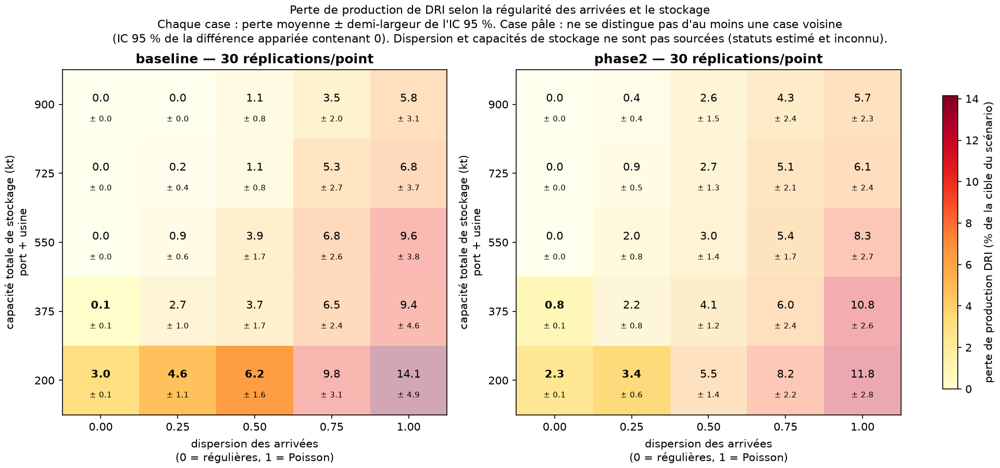
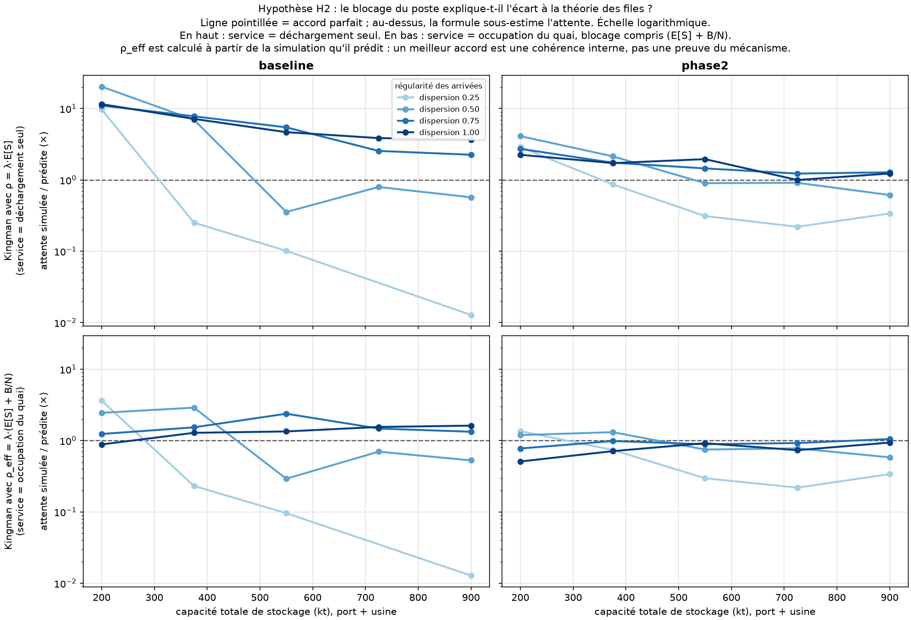
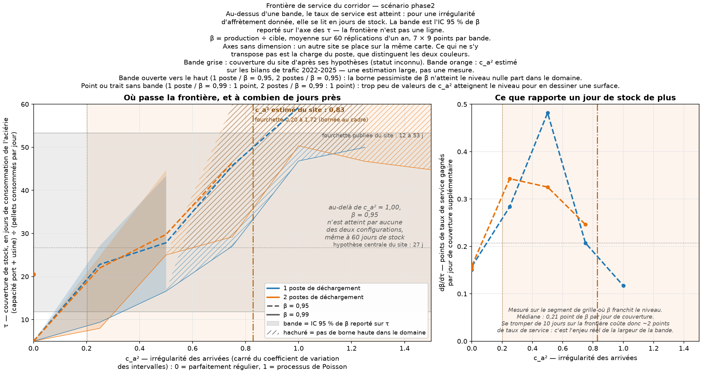

# Jumeau numérique du corridor Djen Djen–Bellara

**Question :** le corridor port de Djen Djen → rail → usine sidérurgique de Bellara
peut-il absorber un doublement de la production ? Si non, quel est le premier goulot ?

> Étude indépendante à but de portfolio, construite uniquement sur des données publiques.
> Non affiliée à Algerian Qatari Steel ni à l'Entreprise Portuaire de Djen Djen.

## État d'avancement

- [x] Semaine 1 : collecte automatique de la situation portuaire (3×/jour)
- [x] Semaines 2–3 : parser, normalisation, table des escales
- [x] Semaines 4–7 : simulation SimPy v1 et analyse de sensibilité
- [ ] Suite : ML, optimisation des stocks, tableau de bord

## Lancer en local

```bash
python -m venv .venv && source .venv/bin/activate   # Windows : .venv\Scripts\activate
pip install -e ".[dev]"
pytest -q                                   # 415 tests, hors ligne
pytest -m slow -q                           # + 5 tests lents : validation analytique
python -m corridor.ingest.port_status       # une collecte
python scripts/inspect_latest.py            # voir le contenu du dernier PDF

python -m corridor.sim.run --scenario baseline --years 1 --reps 50
python -m corridor.sim.sensitivity          # la figure ci-dessous, ~3 min 30
python scripts/h2_blocking.py --reps 30     # hypothèse H2 : blocage du poste, ~5 min
python scripts/poste_stockage_factoriel.py  # plan 2x2 poste x stockage, ~3 min
python scripts/frontiere_service.py --reps 60   # frontière de service, ~25 min
```

## Premiers résultats observés

Ce qui suit n'est pas de la simulation : c'est ce que la série de situations portuaires
collectée du **2026-09-24 au 2026-10-22** (82 collectes, 1 138 observations de navires,
49 escales reconstruites) dit des minéraliers. Reproductible par
`python scripts/ore_calls_report.py`.

### Les quatre escales minerai de la série

| Navire | Tonnage publié | Arrivée | Accostage | Départ encadré | Séjour à quai | Attente en rade | Cadence apparente |
| --- | ---: | --- | --- | --- | ---: | ---: | ---: |
| BERGE NIMBA | 140 571 t | 17/09 06:00 (rade) | 24/09 21:10 | 30/09 18:21 → 01/10 00:27 | ≥ 141,2 h | **183,2 h** | 22 900 – 23 900 t/j |
| GH NIGHTINGALE | 142 533 t | 18/09 20:48 (quai) | 18/09 20:48 | 24/09 15:58 → 24/09 23:03 | ≥ 139,2 h | non mesurable | 23 400 – 24 600 t/j |
| SOMNIUM AUSTRALIS | 138 955 t | 13/10 23:20 (quai) | 13/10 23:20 | 19/10 10:39 → 19/10 19:12 | ≥ 131,3 h | non mesurable | 23 800 – 25 400 t/j |
| IAN M | 141 755 t | pas encore arrivé | — | escale en cours | — | — | — |

IAN M n'est encore qu'une annonce au 2026-10-22 (*Expected Arrivals*, ETA 27/10) : ni rade ni
quai, donc aucune durée. Les trois escales terminées sont passées par le **même poste, QW/7**,
avec des tonnages très proches (139 à 143 kt). Chaque cadence est une fourchette parce que le départ n'est jamais
observé directement : la borne haute suppose le départ le plus tôt possible dans la fenêtre
(`departure_min`), la borne basse le plus tard. C'est une cadence **apparente sur l'occupation
du poste** — amarrage, temps morts et attente de rames compris — et non un débit de grue ; c'est
précisément ce que le modèle appelle `cadence_dechargement`. La moyenne des trois valeurs
centrales, **24 000 t/jour**, a fait passer
[`navires_minerai.cadence_dechargement`](config/assumptions.yaml) du statut *estimé* (25 000,
fourchette [15 000 ; 40 000]) à **observé** (24 000, fourchette [22 900 ; 25 400]).

### Le poste unique crée bien une file : la relève NIGHTINGALE → NIMBA

C'est la seule file d'attente que la série montre directement, et elle est nette :

| Instantané | QW/7 | BERGE NIMBA |
| --- | --- | --- |
| 24/09 15:58 | GH NIGHTINGALE, *iron ore in bulk* | en rade depuis le 17/09 06:00 |
| 24/09 23:03 | **BERGE NIMBA**, accostage publié à 21:10 | à quai |

Entre deux collectes espacées de sept heures, NIGHTINGALE libère QW/7 et NIMBA s'y amarre.
NIMBA avait alors passé **183 h (7,6 jours) en rade**, avec 140 571 t de minerai à bord, et son
accostage tombe dans la fenêtre même du départ du navire précédent. Le poste de déchargement
minerai se comporte donc comme une ressource à exclusion mutuelle : l'attente observée n'est pas
un aléa de navigation, c'est une file devant un quai occupé.

Trois réserves de lecture, parce que cette observation sert d'appui à l'un des résultats du
modèle :

- **la relève est observée, les durées sont publiées.** La série commence le 24/09 15:58 : c'est
  la relève elle-même que nous voyons, d'un instantané au suivant. En revanche l'entrée en rade
  de NIMBA (17/09 06:00) et l'accostage de NIGHTINGALE (18/09 20:48) sont des heures d'événement
  lues dans le PDF, antérieures à notre collecte — les deux escales portent le code
  `left_censored` ;
- **ce n'est pas une file FIFO.** NIMBA attendait en rade depuis le 17/09 alors que NIGHTINGALE
  n'a accosté que le 18/09 : un navire est passé devant. La série ne commençant pas assez tôt,
  on ne sait pas qui occupait QW/7 avant le 18/09 ni pourquoi l'ordre a été celui-là ;
- **un cas n'est pas une statistique.** Une seule attente en rade est mesurable sur toute la
  série minerai. Elle montre que le mécanisme existe, pas à quelle fréquence il joue.

### Ce que ces observations ne permettent pas encore

- **La dispersion des arrivées reste non mesurée.** Quatre arrivées de minéraliers, donc deux
  intervalles seulement : 1,6 jour entre NIMBA et NIGHTINGALE, puis 25,1 jours avant SOMNIUM
  AUSTRALIS. Le schéma — deux arrivées presque simultanées puis près d'un mois de vide — va dans
  le sens d'arrivées très irrégulières, mais `simulation.dispersion_arrivees` **reste de statut
  *estimé*** : on ne tire pas un coefficient de variation de deux intervalles. C'est pourtant
  l'un des deux paramètres qui pilotent tous les résultats ci-dessous.
- **La cadence repose sur 3 navires de même gabarit au même poste.** Rien ne dit ce qu'elle
  vaudrait sur un autre poste ou un autre tonnage. Rien ne prouve non plus que le tonnage publié
  ait été déchargé en entier à Djen Djen : s'il reste du fret à bord, la cadence est surestimée.
  La dispersion inter-navires (`simulation.cv_cadence_dechargement` = 0,15) reste *estimée* : les
  trois valeurs mesurées sont à ± 2,5 % l'une de l'autre, bien moins dispersées, mais trois
  observations ne suffisent pas à resserrer ce coefficient.
- **Les deux capacités de stockage restent de statut *inconnu*** et ce sont elles qui dominent
  les résultats. Aucune observation de la série ne les éclaire.

## Résultats préliminaires

> **Ces chiffres ne sont pas des prévisions.** Les deux paramètres qui les pilotent ne sont
> pas sourcés : la **régularité des arrivées** de minéraliers (statut *estimé*, jamais
> mesurée) et les **capacités de stockage** du port et de l'usine (statut *inconnu*). Le
> reste des hypothèses est documenté, chiffré et daté dans
> [`config/assumptions.yaml`](config/assumptions.yaml).

> **Comment lire les intervalles.** Chaque chiffre est une moyenne sur 50 réplications d'une
> année, suivie de la demi-largeur de son intervalle de confiance à 95 %
> (moyenne ± 1,96 σ/√n). Deux configurations sont comparées **en données appariées** : elles
> partagent la même graine maîtresse, donc la réplication i de l'une et celle de l'autre
> voient la même séquence aléatoire, et c'est l'intervalle de leur *différence* qui décide.
> Un écart est dit **significatif** quand cet intervalle exclut zéro. Le détail est
> reproductible par `python scripts/compare_scenarios.py --reps 50`.

### Le corridor absorbe le doublement — si les navires arrivent régulièrement

50 réplications d'une année, politique d'expédition ferroviaire `pull`.

| Scénario | Arrivées | Production DRI (Mt) | Cible | Perte | Arrêts DRI (h) | Attente en rade (h) | Poste (%) | Rames (%) |
| --- | --- | ---: | ---: | ---: | ---: | ---: | ---: | ---: |
| baseline | régulières | 2,009 ± 0,000 | 2,009 | 0,0 % | 0 ± 0 | 0,0 ± 0,0 | 33,3 ± 0,3 | 36,3 ± 0,0 |
| phase2 | régulières | 4,011 ± 0,002 | 4,017 | 0,1 % | 12 ± 4 | 0,1 ± 0,1 | 66,5 ± 0,4 | 71,3 ± 0,1 |
| phase2 + stockage | régulières | 4,017 ± 0,000 | 4,017 | 0,0 % | 0 ± 0 | 0,1 ± 0,1 | 66,3 ± 0,5 | 72,7 ± 0,0 |
| baseline | Poisson | 1,855 ± 0,059 | 2,009 | **7,6 %** | 633 ± 244 | 276 ± 103 | 55,7 ± 7,2 | 33,2 ± 1,2 |
| phase2 | Poisson | 3,626 ± 0,101 | 4,017 | **9,7 %** | 805 ± 208 | 269 ± 68 | 72,2 ± 4,2 | 64,4 ± 1,9 |
| phase2 + stockage | Poisson | 3,812 ± 0,077 | 4,017 | **5,1 %** | 424 ± 159 | 190 ± 61 | 68,0 ± 3,9 | 67,7 ± 1,6 |

Ce tableau a été recalculé le 2026-10-22 avec la cadence de déchargement **mesurée** sur la
série réelle (24 000 t/jour, voir « Premiers résultats observés » ci-dessus) au lieu des
25 000 t/jour estimés auparavant. **Aucune conclusion ne change** : sur les six lignes, l'écart
apparié de production entre les deux cadences est au plus +0,011 ± 0,111 Mt et n'est
significatif dans aucun cas. Le seul effet significatif est mécanique et attendu — décharger
plus lentement occupe le quai plus longtemps : à arrivées régulières, l'occupation du poste
monte de +1,3 ± 0,0 point en baseline et +2,8 ± 0,2 en phase 2. Les tableaux suivants
(pull/push, second poste, grille de sensibilité, coûts) n'ont **pas** été recalculés : leurs
chiffres de production restent valides au vu de ce test, mais leurs colonnes d'occupation du
poste sont celles de l'ancienne cadence et sous-estiment d'environ 1 à 3 points.

**Régulier contre Poisson : significatif partout.** Sur les trois scénarios, le passage aux
arrivées de Poisson dégrade tous les indicateurs bien au-delà de leur intervalle — par exemple
en baseline, −0,153 ± 0,059 Mt de production, +633 ± 244 h d'arrêt et +276 ± 103 h d'attente.
À demande égale, l'irrégularité de l'affrètement coûte **de l'ordre de 8 à 10 % de la
production annuelle**. Le doublement de production, lui, se passe sans incident tant que les
arrivées restent régulières.

**Pull contre push : presque jamais significatif.** La politique d'expédition ferroviaire ne
change la production de façon certaine que dans **un seul cas sur six** :

| Comparaison pull − push | Production DRI | Verdict |
| --- | ---: | --- |
| baseline, régulières | 0,000 ± 0,000 Mt | non significatif |
| baseline, Poisson | **+0,059 ± 0,040 Mt** | **significatif** |
| phase2, régulières | −0,001 ± 0,002 Mt | non significatif |
| phase2, Poisson | −0,012 ± 0,087 Mt | non significatif |
| phase2 + stockage, régulières | 0,000 ± 0,000 Mt | non significatif |
| phase2 + stockage, Poisson | +0,045 ± 0,071 Mt | non significatif |

Le seul écart systématique est structurel : en `pull`, `rame_blocked_h` vaut zéro par
construction, contre 1 600 à 10 300 h en `push`. L'écart d'attente en rade que suggéraient les
moyennes en baseline/Poisson (297 h contre 204 h) n'est **pas** significatif non plus
(+93 ± 120 h). Autrement dit : la politique d'expédition change ce que font les rames, pas ce
que produit l'aciérie.

**Ce n'est pas le rail qui limite.** Un scénario à six rames au lieu de trois a été testé puis
abandonné : à arrivées régulières il ne change rien (4,011 Mt dans les deux cas, il divise
seulement par deux l'utilisation des rames), et à arrivées de Poisson il ne récupère que
1,4 point de perte (10,0 % → 8,6 %, mesuré à l'ancienne cadence de 25 000 t/jour). Il a été
remplacé par `phase2_plus_stockage`, qui porte
les deux capacités de stockage en haut de leur fourchette et récupère, lui, 4,6 points
(9,7 % → 5,1 %) : à effort comparable, le stockage rend trois fois plus que le rail.

**Un second poste de déchargement ne change pas la production (résultat non concluant).** Le
scénario `phase2_plus_poste` double le poste de déchargement (`postes_minerai` 1 → 2, haut de sa
fourchette) sans toucher au reste. 30 réplications appariées, politique `pull` :

| Phase 2, 1 poste − 2 postes | 1 poste | 2 postes | Production, 2 postes − 1 poste |
| --- | ---: | ---: | --- |
| arrivées régulières | 4,011 ± 0,002 Mt | 4,011 ± 0,002 Mt | 0,000 ± 0,001 Mt, non significatif |
| arrivées de Poisson | 3,515 ± 0,184 Mt | 3,644 ± 0,129 Mt | +0,129 ± 0,157 Mt, non significatif |

À arrivées régulières le poste n'a aucun effet, comme attendu : il n'est occupé qu'à 66 %. En
Poisson, l'estimation ponctuelle va dans le bon sens (+0,13 Mt, attente en rade 291 h → 163 h)
mais **les intervalles contiennent zéro**. Ce test, à 30 réplications, n'établissait donc rien —
ni que le poste unique soit le goulot, ni le contraire. **Il a depuis été tranché à
200 réplications dans un plan factoriel ; voir plus bas.**

### Ce qui limite vraiment : régularité des arrivées × stockage



Grille de 5 dispersions × 5 capacités totales de stockage × 2 scénarios, 30 réplications par
point. La capacité totale balaie la somme des deux fourchettes publiées (200 kt à 900 kt),
répartie entre port et usine selon les proportions des hypothèses centrales. Chaque case porte
sa perte moyenne et la demi-largeur de son IC 95 %. **Une case pâle ne se distingue pas
significativement d'au moins une de ses quatre voisines** (l'IC 95 % de la différence appariée
contient zéro) : la nuance de couleur qui l'en sépare ne doit pas être interprétée.

Quatre lectures :

- **La perte est gouvernée par les deux axes à la fois.** Au coin défavorable (200 kt,
  arrivées de Poisson), la baseline perd 14,1 ± 4,9 % de sa production ; au coin favorable,
  0,0 ± 0,0 %. Toute conclusion sur la capacité du corridor est donc suspendue à deux
  paramètres qu'il reste à mesurer.
- **Le coin fiable est celui des arrivées régulières.** À dispersion 0 et 0,25, les intervalles
  sont étroits (± 0,1 à ± 1,1) et les cases se distinguent nettement les unes des autres. À
  dispersion 0,75 et 1, ils atteignent ± 5 points et la moitié de la carte devient pâle :
  **30 réplications ne suffisent pas pour ordonner ces cases entre elles**. Le gradient global
  reste net, le détail case à case ne l'est pas.
- **Même des arrivées parfaitement régulières ne suffisent pas si le stockage est au plus
  bas** : 3,0 ± 0,1 % de perte en baseline à 200 kt, parce que le tampon ne couvre plus
  l'intervalle entre deux navires. C'est l'un des résultats les plus solides de la carte.
- **La phase 2 est relativement plus robuste que la baseline** à faible stockage (11,8 ± 2,8 %
  contre 14,1 ± 4,9 % à 200 kt et dispersion 1) : deux fois plus de navires, donc des livraisons
  deux fois plus fréquentes et une variance relative plus faible, pour un même tampon. Les
  intervalles se recouvrant, cet écart-là demanderait plus de réplications pour être affirmé.

### Le « stock flottant » en rade n'est pas un tampon : hypothèse réfutée

Un minéralier qui attend en rade porte ~140 000 t de minerai déjà achetées, à quelques heures
du quai. L'hypothèse testée était la suivante : **ce tonnage servirait de tampon flottant que le
corridor peut rappeler dès que le stock usine baisse**, donc plus il est élevé, plus la perte de
production devrait être faible. L'indicateur `waiting_tonnage_mean_t` mesure ce tonnage intégré
dans le temps, puis moyenné sur l'année, exactement comme les heures d'immobilisation des rames.

**La corrélation va dans l'autre sens.** Sur les 50 points de la grille de sensibilité (tous
scénarios, toutes dispersions, toutes capacités) :

| Corrélation stock flottant ↔ perte de DRI | Valeur |
| --- | ---: |
| Pearson, sur les 50 points | **+0,87** |
| Spearman, sur les 50 points | **+0,91** |
| Pearson à stockage fixé (200 / 375 / 550 / 725 / 900 kt) | +0,88 / +0,94 / +0,73 / +0,83 / +0,87 |
| Pearson à dispersion fixée (0,25 / 0,50 / 0,75 / 1,00) | +0,58 / +0,84 / +0,64 / +0,58 |

Plus il y a de minerai en attente en rade, **plus** la production est perdue. La relation tient
en neutralisant chacun des deux axes de la grille séparément, donc elle n'est pas un simple
artefact de la dispersion des arrivées. Le seul coefficient négatif (−0,33 à dispersion nulle)
porte sur des stocks flottants de 0 à 30 tonnes — trois ordres de grandeur sous les autres
points, où ils atteignent 190 000 t : c'est du bruit sur des valeurs nulles, pas un contre-signal.

Le mécanisme se lit directement dans les données de la baseline : le stock flottant monte avec
l'occupation du poste et l'attente en rade, pas contre elles.

| Stockage | Dispersion | Stock flottant | Attente | Occupation du poste | Perte DRI |
| ---: | ---: | ---: | ---: | ---: | ---: |
| 900 kt | 0,00 | 0,0 kt | 0 h | 31,9 % | 0,0 % |
| 550 kt | 0,50 | 2,0 kt | 5 h | 35,2 % | 3,9 % |
| 375 kt | 1,00 | 115,9 kt | 261 h | 57,0 % | 9,4 % |
| 200 kt | 1,00 | 190,3 kt | 446 h | 65,4 % | 14,1 % |

**Le minerai en rade n'est pas un stock mobilisable : c'est du minerai coincé derrière le même
goulot qui affame l'aciérie.** Le poste de déchargement unique serait la ressource contrainte
(hypothèse **non confirmée** : un second poste n'améliore pas la production de façon
significative, voir plus haut) ; quand il sature, le minerai s'accumule en rade *et* le four s'arrête, pour la même raison. Un tampon ne
sert que s'il est en aval du goulot — ici, le stock flottant est en amont.

> **Corrélation n'est pas causalité.** Ces 50 points sont des sorties d'un même modèle, pas des
> observations : la corrélation décrit le comportement du modèle sous ses hypothèses, elle ne
> démontre aucun mécanisme dans le port réel. Elle est de plus mesurée sur des moyennes de points
> de grille, et non sur des réplications individuelles. Enfin, le chiffrage en argent ci-dessous repose sur une hypothèse **estimée** et non
spécifique à l'Algérie.

### Le moteur de file est juste : validation contre Pollaczek-Khinchine

Tous les résultats ci-dessus reposent sur une simulation à événements discrets. Avant de leur
faire confiance, il faut savoir si elle calcule juste. La théorie des files donne un point de
comparaison **exact** : pour une file M/G/1 — arrivées de Poisson, un serveur, service
indépendant de l'état du système — l'attente moyenne vaut exactement

> Wq = λ × E[S²] / (2 × (1 − ρ)),  avec ρ = λ × E[S]   *(Pollaczek-Khinchine)*

La difficulté est la troisième hypothèse : dans le corridor, dès que le stockyard sature, le
navire reste à quai sans décharger et la durée d'occupation du poste dépend de l'état du
système. Le scénario [`baseline_sans_blocage`](config/scenarios/baseline_sans_blocage.yaml)
porte donc les deux capacités de stockage à 10⁹ t : aucun blocage ni aucune rupture n'est
possible, et l'occupation du quai vaut exactement tonnage ÷ cadence.

| Grandeur | Théorie | Simulation (200 réplications × 8 ans) |
| --- | ---: | ---: |
| attente moyenne en rade | **38,53 h** | **37,96 ± 1,40 h** ✅ contient la théorie |
| occupation du poste | ρ = **0,3401** | **0,3404 ± 0,0037** ✅ |

L'horizon de 8 ans n'est pas un réglage de confort, et c'est le point le plus instructif de
cette validation. **À 1 an, le test échoue** : la moyenne simulée est biaisée de −9,4 % sous la
théorie. La cause n'est pas le modèle, c'est la mesure — le système démarre à vide, donc les
premiers navires attendent moins qu'en régime stationnaire, et les navires encore en rade à
l'horizon sont exclus de la moyenne alors que ce sont justement les attentes longues. Avec
~21 navires par an, ce transitoire domine. Pollaczek-Khinchine prédit un régime **stationnaire**,
il faut donc le comparer à une mesure stationnaire :

| Horizon | 1 an | 2 ans | 4 ans | 8 ans | 16 ans |
| --- | ---: | ---: | ---: | ---: | ---: |
| biais de la moyenne simulée | −9,41 % | −4,21 % | −1,84 % | −1,41 % | −0,95 % |
| graines dont l'IC contient la théorie | 10/20 | 13/20 | 19/20 | 19/20 | 17/20 |

(20 graines maîtresses × 200 réplications par case.) Au-delà de 8 ans, l'intervalle se resserre
plus vite que le biais ne décroît : le test redevient fragile sans rien valider de plus.

**Ce que cette validation prouve, et ce qu'elle ne prouve pas.** Elle prouve que la file
d'attente devant le poste est correctement simulée — gestion de la ressource, horloge, lois des
aléas. Elle ne dit **rien** du rail, du four, des stocks, ni des scénarios réalistes, où la
condition d'indépendance du service est précisément violée. Reproductible par
`pytest -q tests/test_analytic.py`.

### Ce qui sature le poste, c'est le stockage plein, pas le déchargement (hypothèse H2)

La validation ci-dessus ne s'applique qu'avec un stockage infini. Dans les scénarios réalistes,
l'attente simulée dépasse largement ce que prédit la théorie appliquée naïvement. **H2** propose
l'explication : le serveur n'est pas « le déchargement » mais « le quai », et sa durée de service
inclut le temps passé à quai sans décharger parce que le stockyard est plein. Le modèle publie
désormais ces heures-là (`berth_blocked_h`), ce qui permet de calculer un service effectif
E[S_eff] = E[S] + B/N et une utilisation effective ρ_eff = λ·E[S_eff].

Arrivées de Poisson, 30 réplications d'un an, approximation de Kingman :

| Scénario | Stockage | Attente simulée | Quai bloqué | ρ | ρ_eff | Kingman(ρ) | Kingman(ρ_eff) |
| --- | ---: | ---: | ---: | ---: | ---: | ---: | ---: |
| baseline | 200 kt | 444 ± 175 h | 3 087 h | 0,34 | 0,75 | 39 h (×11,5) | 503 h (×0,88) |
| baseline | 375 kt | 277 ± 117 h | 2 184 h | 0,34 | 0,61 | 39 h (×7,2) | 216 h (×1,28) |
| baseline | 550 kt | 180 ± 84 h | 1 583 h | 0,34 | 0,53 | 39 h (×4,7) | 134 h (×1,34) |
| baseline | 725 kt | 149 ± 82 h | 1 130 h | 0,34 | 0,48 | 39 h (×3,9) | 96 h (×1,55) |
| baseline | 900 kt | 142 ± 81 h | 1 013 h | 0,34 | 0,46 | 39 h (×3,7) | 88 h (×1,62) |
| phase2 | 200 kt | 358 ± 95 h | 1 586 h | 0,68 | 0,88 | 159 h (×2,3) | 703 h (×0,51) |
| phase2 | 900 kt | 196 ± 85 h | 362 h | 0,68 | 0,72 | 159 h (×1,2) | 209 h (×0,94) |

Le chiffre entre parenthèses est le rapport attente simulée ÷ attente prédite : au-dessus de 1,
la formule sous-estime. La figure couvre les 50 points de la grille :



**Verdict : H2 est soutenue, sur ses deux volets.** Mesuré en |log(simulé ÷ prédit)| sur les
39 cases où une attente est mesurable (dispersion > 0) :

| | avec ρ | avec ρ_eff |
| --- | ---: | ---: |
| toutes cases, écart médian | 1,035 (facteur **2,8×**) | 0,341 (facteur **1,4×**) |
| stockage 200 kt | 1,844 (facteur **6,3×**) | 0,280 (facteur **1,3×**) |
| stockage 900 kt | 0,687 (facteur **2,0×**) | 0,512 (facteur **1,7×**) |

Volet 1 : l'écart avec ρ est bien plus grand quand le stockage est faible — 6,3× à 200 kt contre
2,0× à 900 kt, et en baseline/Poisson le rapport décroît sans exception de ×11,5 à ×3,7 quand on
desserre le stockage. Volet 2 : ρ_eff réduit fortement cet écart, d'un facteur typique de 2,8× à
1,4×, et la correction est d'autant plus forte que le blocage est important (à 200 kt, 6,3× →
1,3× ; à 900 kt, 2,0× → 1,7× seulement).

**Ce que cela change pour la lecture du corridor.** Le poste de déchargement *est* bien saturé
en régime dégradé — jusqu'à 3 087 h de quai immobilisé par an en baseline à 200 kt, pour une
occupation réelle de 0,75 là où le déchargement seul n'en demande que 0,34. Mais il est saturé
**par l'aval**, pas par sa propre cadence. Cela explique qu'un second poste de déchargement
n'améliore pas la production : deux quais bloqués par un stockyard plein ne valent pas mieux
qu'un seul. En revanche, H2 suggérait aussi que **le second poste devrait payer si on desserrait
le stockage en même temps** — cette prédiction-là a été testée, et elle est fausse. Voir la
section suivante.

**Quatre réserves, à lire avant d'en faire un résultat.**

- **C'est de la cohérence interne, pas une validation indépendante.** ρ_eff est calculé à partir
  de la simulation qu'il sert à prédire : il lui emprunte de l'information. Seule la validation
  Pollaczek-Khinchine ci-dessus ne doit rien à la simulation.
- **ρ_eff ne corrige pas, il recentre.** L'erreur ne disparaît pas, elle change de signe par
  endroits : en phase 2 la formule corrigée *sur*estime désormais l'attente (×0,51 à 200 kt), et
  en baseline à fort stockage elle la sous-estime encore (×1,62). L'accord est bien meilleur en
  médiane, il n'est pas bon case par case.
- **La grille ne contient aucune case sans blocage.** Même à 900 kt — le haut des deux
  fourchettes publiées — la baseline perd encore 1 013 h de quai par an. « Stockage faible » est
  donc relatif : tout le domaine exploré est en régime de contre-pression.
- **c_s² reste celui du service sans blocage.** La variabilité du service *effectif* n'est pas
  mesurée et elle est certainement plus grande, ce qui rend Kingman(ρ_eff) encore conservateur.
  Et comme partout ailleurs, dispersion des arrivées et capacités de stockage ne sont pas
  sourcées (statuts *estimé* et *inconnu*).

Reproductible par `python scripts/h2_blocking.py --reps 30` (~5 min).

### Le second poste déplace la file, il ne la supprime pas : un plan factoriel 2 × 2

H2 prédit que le second poste de déchargement ne devrait payer **que** si le stockage est
desserré en même temps. C'est une prédiction testable, et il fallait pour cela la case
manquante : [`phase2_plus_poste_plus_stockage`](config/scenarios/phase2_plus_poste_plus_stockage.yaml),
qui actionne les deux leviers. Quatre configurations, arrivées de Poisson, **200 réplications
appariées** (même graine maîtresse, donc la réplication *i* des quatre voit la même séquence
aléatoire) :

| | Perte DRI | Quai bloqué (h/poste) | Occupation effective | Attente en rade |
| --- | ---: | ---: | ---: | ---: |
| 1 poste, stockage de base | 10,31 ± 1,20 % | 775 ± 104 h | 0,772 ± 0,012 | 237,5 ± 34,3 h |
| 2 postes, stockage de base | 9,40 ± 1,20 % | 2 052 ± 217 h | 0,587 ± 0,025 | 177,8 ± 33,9 h |
| 1 poste, stockage haut | 5,33 ± 0,92 % | 384 ± 88 h | 0,722 ± 0,009 | 184,9 ± 25,5 h |
| 2 postes, stockage haut | 6,17 ± 1,04 % | 869 ± 181 h | 0,437 ± 0,020 | 64,6 ± 18,6 h |

**La prédiction est fausse.** En points de perte de DRI récupérés :

| Levier | Gain | Verdict |
| --- | ---: | --- |
| second poste seul (stockage de base) | +0,90 ± 1,33 | non significatif |
| **stockage seul (1 poste)** | **+4,98 ± 1,50** | **significatif** |
| second poste, stockage déjà haut | **−0,84 ± 1,32** | non significatif |
| les deux leviers ensemble | +4,13 ± 1,50 | significatif |
| interaction (combiné − somme des gains séparés) | −1,75 ± 1,88 | non significative |

Le second poste ne récupère de production dans **aucune** des deux configurations de stockage, y
compris celle où H2 le prédisait. Il n'y a pas d'interaction : les deux leviers ensemble
(+4,13) ne font pas mieux que le stockage seul (+4,98), l'écart étant du bruit. **Tout le gain
vient du stockage.**

**Mais le poste n'est pas sans effet — il déplace la file.** Les trois indicateurs de congestion
bougent tous de façon significative quand on ajoute un poste :

| Variation (2 postes − 1 poste) | à stockage de base | à stockage haut |
| --- | ---: | ---: |
| attente en rade | **−59,7 ± 49,3 h** | **−120,3 ± 32,0 h** |
| quai bloqué, par poste | **+1 277 ± 242 h** | **+486 ± 201 h** |
| occupation effective | **−0,185 ± 0,028** | **−0,285 ± 0,022** |

Les navires accostent plus tôt — l'attente en rade baisse nettement — mais ils passent alors à
quai le temps qu'ils passaient en rade, immobilisés faute de place au stockyard : le blocage par
poste est multiplié par 2,6 à stockage de base. **La file n'a pas disparu, elle a changé
d'endroit.** Et comme ce qui plafonne la production est le débit que le stockage et le rail
peuvent absorber, la déplacer ne produit pas une tonne de plus.

C'est le résultat qui tranche la question laissée ouverte depuis le test à 30 réplications : le
poste de déchargement **n'est pas** la ressource contrainte du corridor, ni seul ni en
combinaison. Il faut y ajouter les réserves habituelles : les deux capacités de stockage sont de
statut *inconnu* et « stockage haut » est le haut de leurs fourchettes, `postes_minerai = 1`
repose sur une seule observation, et tout ceci décrit le modèle, pas le port.

Reproductible par `python scripts/poste_stockage_factoriel.py --reps 200` (~3 min).

### La frontière de service : deux nombres suffisent à décider du corridor

Tout ce qui précède tient dans une seule carte, à deux axes **sans dimension** — ce qui permet
de la transposer à un autre port.

- **c_a²** : le carré du coefficient de variation des intervalles entre arrivées. 0 = navires
  parfaitement réguliers, 1 = processus de Poisson, au-delà = arrivées groupées. C'est la
  régularité de l'affrètement, indépendamment de sa cadence.
- **τ = (K_P + K_U) / D** : la capacité de stockage totale (port + usine) divisée par la
  consommation journalière de pellets de l'aciérie, soit un **nombre de jours de couverture**.
  « 450 kt » ne veut rien dire hors contexte ; « 27 jours de couverture » si.

La grandeur lue est le **taux de service β = production ÷ cible**. β = 0,95 signifie « 5 % de la
production annuelle perdue faute d'approvisionnement ».



Couverture τ requise pour tenir un niveau de service (scénario phase 2, 60 réplications d'un an
par point, 7 × 9 points par courbe) :

| c_a² | 0,00 | 0,25 | 0,50 | 0,75 | 1,00 (Poisson) | 1,25 | 1,50 |
| --- | ---: | ---: | ---: | ---: | ---: | ---: | ---: |
| **β = 0,95**, 1 poste | ≤ 5 j | 22,8 j | 27,8 j | 45,8 j | 59,2 j | hors d'atteinte | hors d'atteinte |
| **β = 0,95**, 2 postes | ≤ 5 j | 22,0 j | 29,8 j | 46,5 j | hors d'atteinte | hors d'atteinte | hors d'atteinte |
| **β = 0,99**, 1 ou 2 postes | 20,5 j | hors d'atteinte | hors d'atteinte | hors d'atteinte | hors d'atteinte | hors d'atteinte | hors d'atteinte |

« Hors d'atteinte » = le niveau n'est pas atteint dans le domaine exploré, soit jusqu'à 60 jours
de couverture. Quatre lectures :

- **La frontière est très raide.** Passer d'arrivées parfaitement régulières à un processus de
  Poisson multiplie par plus de dix la couverture nécessaire pour tenir 95 % : de moins de
  5 jours à une soixantaine. L'irrégularité de l'affrètement n'est pas un facteur parmi
  d'autres, c'est **le** facteur dimensionnant.
- **Les courbes à 1 et 2 postes sont superposées.** Le nombre de postes de déchargement ne
  déplace pas la frontière de service, à aucun niveau d'irrégularité. C'est le même résultat que
  le plan factoriel ci-dessus, obtenu par un chemin indépendant et sur tout le domaine plutôt
  que sur deux points.
- **β = 0,99 est hors d'atteinte dès que les arrivées cessent d'être régulières**, même avec
  60 jours de stock. Viser un taux de service de 99 % sur ce corridor est un problème
  d'affrètement, pas un problème de stockage : aucune quantité de silo ne l'achète.
- **Le site se situe vers 27 jours de couverture** (12 à 53 selon la fourchette publiée, d'où la
  bande grise — les deux capacités sont de statut *inconnu*). Cela tient 95 % jusqu'à c_a² ≈ 0,5,
  c'est-à-dire des arrivées modérément irrégulières. À régime de Poisson, il en faudrait plus du
  double.

**C'est ici que l'étude bute sur ce qu'elle ne sait pas.** L'axe vertical est incertain d'un
facteur quatre (12 à 53 jours) et **la position du site sur l'axe horizontal est inconnue** :
`dispersion_arrivees` n'est toujours pas mesurée, faute d'assez d'arrivées de minéraliers dans la
série (4 à ce jour, soit 2 intervalles). La carte ne donne donc pas un verdict sur Djen Djen —
elle dit exactement **quelle mesure trancherait**, et c'est la raison d'être de la collecte qui
continue de tourner.

Trois réserves de lecture. β est une moyenne sur 60 réplications, de demi-largeur d'IC ±0,01 à
±0,03 selon les cases : les contours sont tracés sur les moyennes, donc la position exacte d'une
courbe vaut à quelques jours près. La grille fait 7 × 9 points, interpolés linéairement. Enfin
la carte vaut pour le scénario phase 2 ; ce qui ne se transpose pas d'un site à l'autre est la
charge du poste ρ = λ·E[S]/c, qui est précisément ce que distinguent les deux couleurs.

Reproductible par `python scripts/frontiere_service.py --reps 60` (~25 min), ou
`--from-parquet data/sim/frontiere_service.parquet` pour retracer la figure sans resimuler.

### Ce que cela coûte : ordres de grandeur seulement

`couts.cout_journee_arret_dri` vaut 130 000 USD/jour, fourchette [40 000 ; 230 000], statut
`estimé` : il est dérivé de marges de fours à arc électrique chinois sur le rond à béton
(7 à 44 USD/t), pas de données algériennes. Il correspond à une journée de production de la
capacité actuelle (~22 USD/t, [7 ; 40]). `python scripts/economic_summary.py` convertit la perte
de production (politique `pull`, 30 réplications) en coût annuel ; la fourchette cumule l'IC 95 %
de la simulation et celle de l'hypothèse :

| Scénario | Arrivées | Perte de DRI | Coût annuel (fourchette) |
| --- | --- | ---: | ---: |
| baseline | régulières | ≈ 0 | < 1 M USD |
| baseline | Poisson | 0,16 ± 0,08 Mt | ~4 M USD (1 à 10) |
| phase 2 | régulières | ≈ 0 | < 1 M USD |
| phase 2 | Poisson | 0,50 ± 0,18 Mt | ~11 M USD (2 à 27) |
| phase 2 + stockage | Poisson | 0,23 ± 0,09 Mt | ~5 M USD (1 à 13) |
| phase 2 + second poste | Poisson | 0,37 ± 0,13 Mt | ~8 M USD (2 à 20) |

Ces montants sont **des ordres de grandeur**, arrondis au million : ils dépendent d'une marge
étrangère au site, d'une dispersion des arrivées non mesurée et de capacités de stockage
inconnues. Ils servent à comparer des scénarios entre eux, pas à chiffrer un préjudice.

### Limites de ces résultats

La table des escales tourne désormais sur une vraie série (82 collectes du 2026-09-24 au
2026-10-22, 49 escales reconstruites, 31 exploitables) et c'est d'elle que vient la cadence de
déchargement mesurée plus haut. Mais ses sorties n'ont pas été confrontées une à une à ce que
le port publie, et les transitions du cycle de vie des navires restent validées sur des
séquences synthétiques : `tests/fixtures/` ne contient qu'un seul PDF réel. Les exports, la houle, les surestaries et les temps morts à
quai sont hors périmètre de la v1. Le détail figure dans [CLAUDE.md](CLAUDE.md), section
« Limites connues ».

## Données collectées

La collecte tourne 3×/jour sur GitHub Actions et sépare trois choses :

| Quoi | Où | Versionné |
| --- | --- | --- |
| PDF bruts, un par collecte | releases `raw-AAAA-MM` | non (assets de release) |
| Index des collectes | `data/raw/port_status/_manifest.csv` | oui |
| Observations de navires | `data/clean/observations.csv` | oui |

Le manifeste trace chaque tentative (`new`, `unchanged`, `error`), l'empreinte du fichier,
l'empreinte du **contenu** et la référence de l'asset de release. Les PDF ne sont pas dans
git : à ~580 Ko pièce et 3 collectes par jour, le dépôt aurait grossi de ~600 Mo par an.
Pour tout reparser en local :

```bash
python scripts/fetch_raw.py                               # récupère les PDF des releases
python -m corridor.transform.observations_csv --rebuild    # régénère la table propre
```

**Un piège de la source, à connaître avant de réutiliser ces données.** L'en-tête du PDF
(« Djen-Djen : AAAA-MM-JJ HH:MM ») est l'heure à laquelle le serveur du port **génère le
document** : elle coïncide à la minute près avec l'heure de téléchargement. Ce n'est pas
l'heure de mise à jour des données, que le PDF ne publie nulle part. Deux PDF décrivant la
même situation diffèrent donc toujours octet par octet, et c'est l'empreinte du contenu
(navire, statut, poste, cargaison, tonnage, heure d'événement) qui dit si la situation a
changé — sur les 82 premières collectes, 18 ont décrit une situation déjà vue.

Les sorties de simulation vont dans `data/sim/*.parquet` (git-ignorées : elles se
recalculent). Les figures versionnées sont dans `docs/`.
